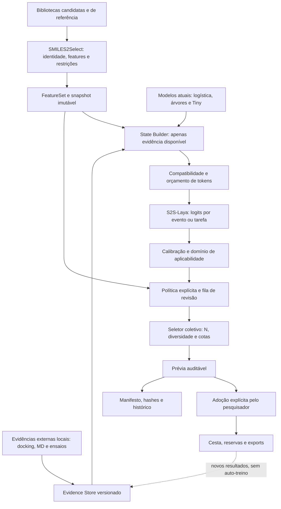
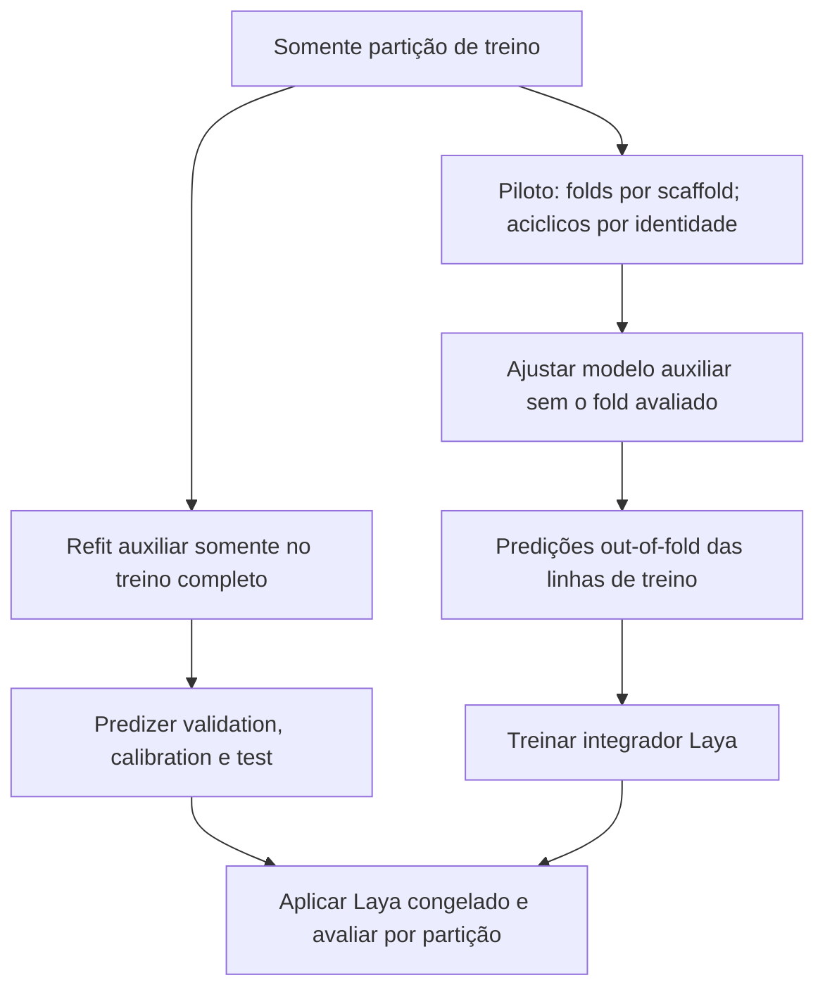
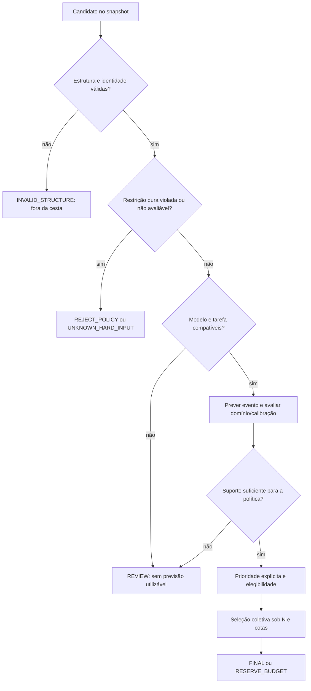
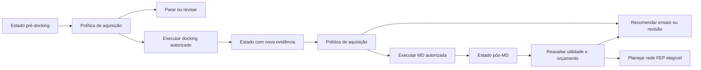
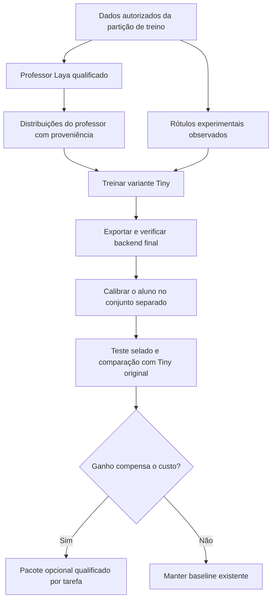
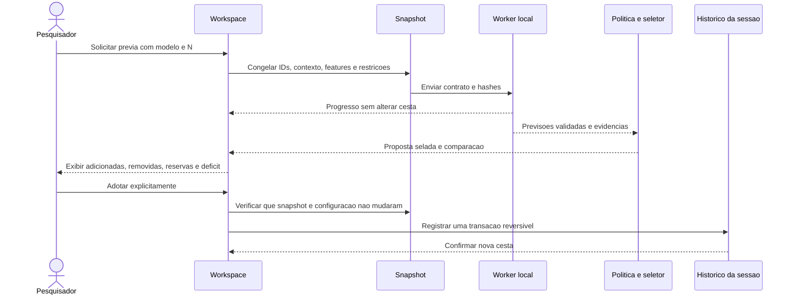
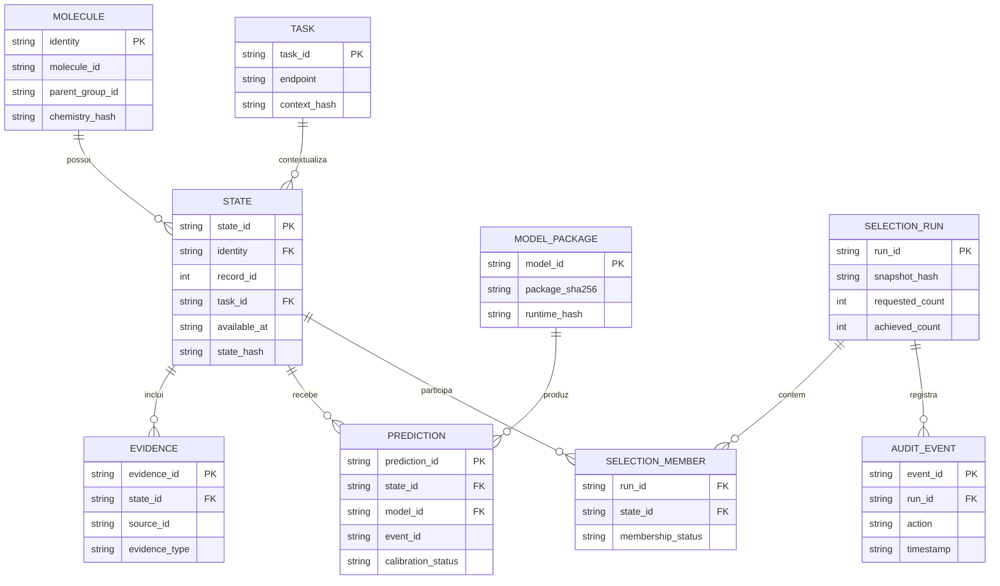

# S2S-Laya — Arquitetura completa de seleção molecular e decisão sequencial

**Projeto:** SMILES2Select  
**Responsável pelo projeto:** Adriano Marques Gonçalves  
**Documento:** especificação técnica e científica para desenvolvimento  
**Versão:** 1.1 — 4 de outubro de 2026  
**Status:** plano científico revisado; primeira entrega de pesquisa implementada e piloto concluído via `run-001` + `recovery-001`. Nenhuma das três seeds passou no gate científico; gate de recursos passou. Expansão automática deste Laya encerrada, preservando baselines.  
**Primeira entrega:** harness de pesquisa local com auditoria dos dados, baselines numéricos, diagnóstico real do Laya e piloto supervisionado da cabeça. Integração gráfica e distribuição dependem dos marcos científicos abaixo.  
**Idioma do documento:** português. Identificadores, contratos e textos enviados ao checkpoint inglês permanecem em inglês.

> **Decisão central:** preservar os modelos e o seletor atuais; testar se o Laya acrescenta valor frente a stackers numéricos com exatamente as mesmas informações; separar previsão, política e seleção coletiva; integrar ou destilar somente após os marcos pertinentes. O aplicativo não deve passar a exigir GPU, PyTorch ou serviço externo.

**Origem preservada:** revisão integral do anexo `S2S_Laya_Arquitetura_Completa.md`, versão 1.0, cujo SHA-256 é `b4f951a2f4d45ca43939b38a97dcd080607592907206253c470718b395979eac`. O anexo original permanece inalterado. A comparação de contratos utilizou o checkout `9023af41d7f1001028a3dc60e131b4d2216a8127`. As seções posteriores descrevem também extensões futuras; somente o escopo inicial e os marcos liberados compõem a primeira implementação.

**Registro das revisões 1.1:**

- Preservados `record_id` inteiro, `molecule_id` de origem, `identity` químico e a receita atual que remove estereoquímica; corrigidos o intervalo e o sentido do score.
- Acrescentados stackers com entradas OOF idênticas às do Laya, abstenção explícita e métricas sobre universo comum e cardinalidade alcançada.
- CA2 passa a teste técnico; AChE usa as partições B15 congeladas para exploração. Um holdout realmente intocado permanece pendente e separado.
- Corrigidas a destilação Bernoulli do Tiny, sua cabeça contínua e as unidades de utilidade/custo na proposta de VOI.
- Infraestrutura permanece neutra ao backend. RLCD, destilação, GUI, armazenamento de trajetórias e aquisição sequencial ficam após seus marcos científicos.
- Definidos critérios operacionais de continuidade na seção 26.2. Eles serão selados antes dos ajustes e não poderão ser reduzidos após resultados desfavoráveis.

**Diagramas:** os oito desenhos de arquitetura estão em Mermaid, como código editável no próprio Markdown. As descrições textuais preservam a leitura dos fluxos em visualizadores sem suporte a Mermaid.

## Sumário

1. [Objetivo, requisitos e limites](#s01)
2. [Estado atual do SMILES2Select e estratégia de integração](#s02)
3. [Laya: capacidades verificadas e correções importantes](#s03)
4. [Arquitetura geral e modos de execução](#s04)
5. [Componentes e responsabilidades](#s05)
6. [Identidade química, tarefas e estágios](#s06)
7. [Fontes de dados e curadoria](#s07)
8. [Rótulos e perguntas que podem ser aprendidas](#s08)
9. [Features e construção do estado molecular](#s09)
10. [Contratos de dados e exemplos](#s10)
11. [Particionamento, temporalidade e prevenção de leakage](#s11)
12. [Fine-tuning supervisionado e comparação com RLCD](#s12)
13. [Calibração, domínio de aplicabilidade e abstenção](#s13)
14. [Política de decisão e seleção de N moléculas](#s14)
15. [Docking, dinâmica molecular, MM-GBSA e FEP](#s15)
16. [Decisão sequencial e valor da informação](#s16)
17. [Destilação para S2S-Decision Tiny](#s17)
18. [Integração com o repositório e contratos de software](#s18)
19. [Empacotamento, ONNX e execução offline](#s19)
20. [Persistência, proveniência e reprodutibilidade](#s20)
21. [Interface gráfica e experiência de uso](#s21)
22. [Validação científica e desenho dos benchmarks](#s22)
23. [Testes de engenharia e critérios de aceitação](#s23)
24. [Hardware, memória e desempenho](#s24)
25. [Segurança, privacidade e licenciamento](#s25)
26. [Plano de desenvolvimento e marcos de decisão](#s26)
27. [Configuração inicial proposta](#s27)
28. [Riscos, alternativas e decisões arquiteturais](#s28)
29. [Orientações para implementação com Codex](#s29)
30. [Referências e fontes verificadas](#s30)

---

<a id="s01"></a>
## 1. Objetivo, requisitos e limites

### 1.1. Problema a resolver

O SMILES2Select deve reduzir uma biblioteca quimicamente elegível a um conjunto final de **N moléculas**, levando em conta a tarefa biológica, as evidências disponíveis, a diversidade e as restrições explícitas do pesquisador. O S2S-Laya é uma extensão para estudar se a integração aprendida dessas evidências melhora essa escolha, em comparação com o seletor químico, os modelos tabulares e o Tiny existentes.

Em uma segunda frente, o sistema poderá recomendar quais evidências adquirir em seguida: preparação, docking, refinamento de pose, dinâmica molecular ou outra análise. Essa recomendação não executará automaticamente tarefas caras. O estudo de alocação de recursos será um módulo posterior, dependente de registros históricos adequados.

### 1.2. Requisitos obrigatórios

| ID | Requisito | Implicação arquitetural |
|---|---|---|
| R01 | Inferência e dados de candidatos locais | Nenhuma estrutura é enviada a API, telemetria ou serviço remoto. |
| R02 | Aplicativo principal leve | Tiny e modelos atuais continuam disponíveis em CPU; treinamento fica em ambiente separado. |
| R03 | Quantidade final explícita | O seletor busca N sem duplicar moléculas ou violar restrições duras. |
| R04 | Resultado numérico e auditável | Não há geração livre de justificativas científicas pelo Laya. |
| R05 | Compatibilidade química | Treino e inferência compartilham a mesma receita versionada de features. |
| R06 | Adoção humana explícita | Uma prévia nunca substitui a cesta atual; adoção é reversível. |
| R07 | Evidência ausente permanece ausente | Não transformar desconhecido em inativo, seguro, incompatível ou falha experimental. |
| R08 | Separação entre previsão e decisão | `activity_probability` não é `priority_score`, nem probabilidade universal de sucesso. |
| R09 | Comparação justa | Laya precisa ser comparado com baselines nas mesmas tarefas, dados e restrições. |
| R10 | Reprodutibilidade | Versões, hashes, splits, seeds, contexto e política acompanham cada execução. |

**Semântica de N:** N é um objetivo de cardinalidade, não autorização para desrespeitar exclusões. Se a seleção for inviável, retornar a quantidade alcançada, o déficit e os conflitos. Não preencher a cesta com moléculas inválidas nem relaxar restrições silenciosamente.

### 1.3. O que não está sendo proposto

O módulo não será um preditor universal de atividade, um substituto dos ensaios ou uma prova de segurança. Não se assume que um encoder textual compreenda geometria molecular. Não se assume que um modelo maior supere regressão logística, árvores ou Tiny. Não será obrigatório executar a sequência docking → MD → MM-GBSA → FEP em todas as campanhas.

O ajuste do Laya pode continuar sendo, em parte, um **modelo QSAR ou um empilhamento de preditores**, quando o desfecho é atividade. A inovação de decisão sequencial só poderá ser reivindicada se o sistema realmente modelar decisões, custos e resultados de aquisição de evidência, e for validado nesse problema.

---

<a id="s02"></a>
## 2. Estado atual do SMILES2Select e estratégia de integração

### 2.1. Base verificada

A inspeção do repositório foi feita sobre o commit:

```text
amgoncalvesusp/SMILES2Select
9023af41d7f1001028a3dc60e131b4d2216a8127
```

O README consultado descreve a versão **3.5.0**, com seleção química padrão, propostas de modelos, Tiny, pacotes ONNX e seleção contextual experimental. Portanto, este documento **não propõe reconstruir o S2S-Decision do zero**. [R1–R5]

Entre os recursos documentados estão 12 alternativas ONNX, distribuídas em três tarefas com quatro famílias por tarefa, e nove pacotes contextuais correspondentes a três preditores logísticos com três variantes de calibração. Não são nove modelos biológicos independentes. O README também registra que o modelo contextual maior não melhorou consistentemente a recuperação retrospectiva sobre a logística. Isso reforça a necessidade de demonstrar benefício antes de adicionar complexidade. [R1, R2]

### 2.2. Recursos a preservar

Preservar a separação entre regras, scores, alertas e política; o fluxo de preview/adoption; as cotas e a diversidade; as decisões manuais; a persistência `.s2s.sqlite`; os hashes de modelos; o processamento em blocos; o cancelamento; os exports e os instaladores sem ambiente de treinamento. [R1–R5]

O contrato de features inspecionado define `s2s-tiny-features/1`, 16 descritores básicos, quatro indicadores adicionais e sete features de contexto, além de fingerprints. Sua constante padrão é de 2.048 bits. A integração deve reutilizar esse contrato e criar extensões versionadas, não modificar a ordem existente silenciosamente. [R4]

### 2.3. Pontos concretos de integração

| Caminho existente inspecionado | Papel atual | Uso na proposta |
|---|---|---|
| `src/s2s_decision/schema.py` | `FeatureSet`, nomes e ordem de features | Adaptador entre features existentes e estado S2S-Laya. |
| `src/s2s_decision/decision.py` | Inspeção de pacote, compatibilidade e preview | Preservar validações; adicionar despacho explícito por backend. |
| `src/s2s_decision/contextual_decision.py` | Proposta contextual sobre snapshot | Reutilizar o fluxo transacional, não contornar a adoção. |
| `src/s2s_decision/contextual_model.py` | Pacote contextual logístico | Manter seu formato; Laya terá formato próprio. |
| `src/s2s_decision/contextual_policy.py` | Política, evidências e fila informativa | Compartilhar semântica de restrições e desconhecidos. |
| `src/smiles2select/gui/workspace/contextual_controls.py` | Controles de proposta contextual | Ponto de extensão de UI, com testes de regressão. |

A existência desses caminhos e os contratos citados foram verificados; não foi realizada uma auditoria completa de todas as funções, nem executada a suíte do repositório. Os nomes dos novos módulos apresentados adiante são **propostas**. [R3–R5]

### 2.4. Estratégia escolhida

Começar por um harness experimental separado do runtime desktop. Reutilizar artefatos, química, splits e seletor atuais; adicionar apenas contratos de evidência/estado que não dependam de Laya e um adaptador concreto para a revisão upstream fixada. Não criar uma hierarquia de plugins antes de existir uma segunda necessidade real. Um pacote Laya não pode se passar por pacote `s2s-contextual-logistic/1` ou pelo ONNX do Tiny: tokenizer, assinatura de entrada, calibração e runtime são diferentes.

A seleção química atual permanece padrão. A preferência por qualquer novo modelo depende de qualificação científica por tarefa e de decisão explícita de produto.

---

<a id="s03"></a>
## 3. Laya: capacidades verificadas e correções importantes

### 3.1. O que está documentado

O checkpoint raiz `convaiinnovations/laya` é apresentado como um modelo não autorregressivo de aproximadamente 421 milhões de parâmetros, com ModernBERT-large e cabeça de decisão. O SDK recebe estado e perguntas tipadas, incluindo `choice`, `score` e `noul`. O checkpoint raiz é orientado a inglês. [R6]

O model card registra contexto padrão de 512 tokens e orçamento de cabeça de 192 no checkpoint inglês. O orçamento efetivo precisa ser verificado no runtime: não se deve assumir que um JSON extenso será lido integralmente. [R6, R7]

Há exemplos oficiais de treinamento com RLCD, exportação e calibração, além de um caminho ONNX. A documentação do repositório e o model card não estão perfeitamente sincronizados: o README consultado anuncia 0.3.26, enquanto o card ainda destaca 0.3.20. **Fixar revisão e testar a combinação efetivamente instalada.** [R6–R9]

### 3.2. Correções em relação à ideia inicial

| Ideia inicial | Especificação corrigida |
|---|---|
| “421 M é uma alternativa ultraleve ao Tiny.” | É uma alternativa de pesquisa substancialmente maior; Tiny continua sendo a rota leve. |
| “As probabilidades já são confiáveis por causa do RLCD.” | Calibração precisa ser medida no domínio e no backend final. |
| “Papyrus ensina diretamente quando avançar para MD/FEP.” | Papyrus fornece bioatividade; decisões e custos exigem outros registros. |
| “Três classes medem automaticamente a incerteza.” | `REVIEW` é uma ação; incerteza precisa de sinais próprios e validação. |
| “`score` produz naturalmente pIC50.” | `score` é ordinal; regressão contínua exige head ou modelo específico. |
| “Ausência de geração elimina erros.” | Classificações e probabilidades podem estar erradas, mesmo em formato válido. |
| “Dar o SMILES ao modelo cria compreensão química.” | O JSON deve conter evidências adequadas; representação estrutural precisa de baseline próprio. |
| “Um forward responde a tudo sem custo adicional.” | Há expansão e batching de perguntas; o custo cresce com exemplos, tokens e opções. |

### 3.3. Salvaguardas específicas do Laya

O card documenta comportamento problemático de `noul` e ausência de sinal útil em `action.act_probability`. Por isso, o primeiro experimento usará **`choice` binário com opções neutras**, e não utilizará a cabeça de ação como probabilidade de avanço. [R6]

`confidence`, `answer_confidence`, probabilidade da classe ativa e entropia não serão tratados como sinônimos. O adaptador deverá identificar o significado exato de cada campo na revisão fixada. A decisão de abstenção será da camada S2S, baseada na probabilidade do evento, evidência de domínio, calibração e completude do estado. [R7]

### 3.4. Revisões de referência

```text
Laya upstream inspecionado em 2026-10-04:
79f671b235418ff6f2f572aee7709bac30392f51

Modelo de origem:
convaiinnovations/laya
```

O SHA acima identifica o **código**, não os pesos do Hugging Face. O build deve resolver e registrar separadamente a revisão dos pesos, os hashes dos arquivos e o tokenizer. Este documento não fixa um SHA de pesos que não foi verificado.

---

<a id="s04"></a>
## 4. Arquitetura geral e modos de execução

### 4.1. Visão de componentes



**Leitura alternativa:** dados locais → features atuais + evidências disponíveis → estado compacto → modelo → calibração/domínio → política → seletor N/diversidade → prévia → adoção → exportação. Novos resultados retornam ao repositório de evidências, mas não alteram automaticamente o modelo.

### 4.2. Três modalidades

| Modalidade | Finalidade | Runtime | Status previsto |
|---|---|---|---|
| **Baseline/Tiny atual** | Seleção local leve | Pacotes e ONNX existentes | Preservado desde o primeiro marco. |
| **Laya direto** | Pesquisa de integração e decisão | Ambiente local separado, PyTorch ou ONNX qualificado | Opcional e experimental. |
| **Tiny destilado** | Transferir eventual ganho ao aplicativo leve | ONNX CPU com contrato próprio | Somente após validação da destilação. |

Não carregar três checkpoints de linguagem para um estado estruturado em inglês. Usar um checkpoint explicitamente selecionado; evitar roteamento linguístico automático que possa mudar o modelo em função de um nome de alvo ou texto de metadados.

### 4.3. Fronteira entre aplicação e pesquisa

A aplicação produz um snapshot imutável e recebe resultados numéricos de um worker local. O worker pode ser um processo separado conectado por arquivos JSONL e um manifesto de job. Essa escolha evita dependências pesadas na GUI e não exige servidor HTTP.

O treinamento ocorre em outro ambiente, com PyTorch e ferramentas de preparação. Pacotes aprovados são importados manualmente. Download de dados e pesos é uma etapa administrativa explícita; a inferência de candidatos deve funcionar com rede bloqueada.

### 4.4. Modo de contingência

Se o Laya falhar, a cesta atual permanece intacta. O usuário pode escolher um baseline já disponível. Não substituir silenciosamente o Laya por Tiny ou por uma regra diferente enquanto mantém o mesmo nome de modelo no relatório.

---

<a id="s05"></a>
## 5. Componentes e responsabilidades

| Componente proposto | Entrada | Saída | Responsabilidade e limite |
|---|---|---|---|
| `SourceAdapter` | Arquivos locais de uma fonte | Registros normalizados | Preservar proveniência; não inventar dados ausentes. |
| `IdentityResolver` | Estrutura e aliases | Identidades e grupos químicos | Reutilizar a química atual; não eliminar estereoquímica sem política. |
| `TaskRegistry` | Alvo, espécie, endpoint e protocolo | `task_id` e esquema de evento | Bloquear tarefas incompatíveis. |
| `EvidenceStore` | Medições e resultados computacionais | Evidências com tempo e origem | Separar medição, predição, anotação e heurística. |
| `FeatureAdapter` | `FeatureSet` existente | Features de estado e vetores | Manter versão e ordem. |
| `StateBuilder` | Features + contexto + instante da decisão | Estado compacto | Aplicar whitelist, máscara de disponibilidade e limite de tokens. |
| `QuestionRegistry` | Tarefa habilitada | Perguntas tipadas fixas | Versionar ordem das opções e significado dos rótulos. |
| `LayaBackend` | Estado e perguntas | Logits e metadados técnicos | Não aplicar política química nem escolher a cesta. |
| `CalibrationLayer` | Logits e contexto | Probabilidades calibradas ou status não qualificado | Evitar dupla calibração. |
| `DomainMonitor` | Features e referências permitidas | Domínio, distância e alertas | Não transformar similaridade em certeza de atividade. |
| `DecisionPolicy` | Predições, domínio e restrições | Recomendações e prioridade | Explicitar preferências e motivos de revisão. |
| `BudgetedSelector` | Pool elegível e prioridade | Cesta, reservas, déficit | Reutilizar seleção atual; respeitar N e cotas. |
| `PreviewAdapter` | Cesta proposta e snapshot | Prévia selada | Garantir adoção explícita e invalidação após mudanças. |
| `TrainingPipeline` | Dados e splits congelados | Checkpoints e avaliação | Não acessar teste para ajustar modelos. |
| `ModelRegistry` | Pacote e relatórios | Disponibilidade por tarefa | Carregar apenas pacotes compatíveis e íntegros. |

Interfaces devem ser pequenas e testáveis. Uma troca de backend não pode mudar regras químicas, definição de atividade ou semântica de N. A tabela descreve responsabilidades, não exige uma classe ou arquivo por linha. Na primeira entrega, não implementar `EvidenceStore`, registros genéricos, migrações SQLite, servidor nem GUI novos. Manifestos e tabelas locais bastam para o experimento.

---

<a id="s06"></a>
## 6. Identidade química, tarefas e estágios

### 6.1. Hierarquia de identidades

Preservar os identificadores existentes e acrescentar somente os agrupamentos exigidos pelo experimento:

```text
source_record_id  -> linha original e fonte, quando disponíveis
record_id         -> inteiro único da linha no workspace; nunca trocar por UUID/string
molecule_id       -> identificador de origem já preservado pelo software; não é identidade química
identity          -> hash químico existente do SMILES padronizado segundo o manifesto
parent_group_id   -> agrupamento versionado para independência; não sobrescreve identity
state_id          -> hash do snapshot de decisão, tarefa e evidências disponíveis
microstate_id     -> extensão futura; não exigida pelo piloto pré-docking
```

Sal, composto parental e microestado não são necessariamente o mesmo objeto experimental. Guardar a transformação aplicada e o SMILES original. Misturas, metais e estruturas que não possam ser padronizadas devem ser reportados, não “corrigidos” por adivinhação. O modelo atual usa `StandardizationConfig(remove_stereo=True)` em `features.py`; seu `identity` é SHA-256 do SMILES padronizado. O piloto mantém essa receita e registra seu limite. Não alegar identidade estereoespecífica nem recuperar estereoquímica já removida. Uma representação que preserve estereoquímica precisará de contrato, features e avaliação próprios, mantendo a visão antiga para reprodução. [R1, R4, R16]

`state_id` é a identidade do estado de decisão, não sinônimo de `microstate_id`. Vários snapshots temporais podem usar o mesmo microestado químico.

Ao selecionar N, a unidade padrão é **molécula**, não pose ou conformero. Estados alternativos não podem ocupar múltiplas vagas sem uma opção explícita de seleção por estado.

### 6.2. Definição de tarefa

Uma tarefa de atividade é identificada por:

```text
target accession + variant + species + endpoint + assay family
+ threshold + relation + unit + label policy version
```

Exemplo: atividade em um ensaio de Ki de CA2 humana a um limiar de 1.000 nM é uma tarefa distinta de IC50 de CA2, de Ki em outra espécie ou do mesmo endpoint a 10 nM. Mudar uma descrição textual não cria um modelo capaz de generalizar entre essas tarefas. O pacote CA2 atual registra `pooled_biochemical` e contextos de hidratação/desidratação de CO₂; não renomeá-los como ensaio de ligação direta. `variant` permanece `null`/não resolvida quando a fonte não demonstra WT; o pacote não ganha especificidade de variante por preenchimento automático. O `TaskSpec` novo deve distinguir metadado não resolvido de incompatibilidade comprovada e recusar uma tarefa mais específica que a evidência disponível. [R2]

Para alvos novos sem treinamento e avaliação apropriados, o resultado é `UNSUPPORTED_TASK`, não uma probabilidade inventada. Modelos multialvo podem ser estudados posteriormente com representações de proteína e testes de alvo não visto, mas essa capacidade não é pressuposta.

### 6.3. Dois conceitos de estágio

| Campo | Exemplos | Significado |
|---|---|---|
| `discovery_stage` | `hit_finding`, `lead`, `fragment` | Contexto de política do projeto, já presente no fluxo contextual. |
| `evidence_stage` | `pre_docking`, `post_docking`, `post_md`, `post_fep` | Quais evidências estavam disponíveis ao fazer a previsão. |

Esses eixos não são intercambiáveis. Uma molécula em `lead` pode estar em `pre_docking`; escolher `post_md` não autoriza usar resultados de FEP ainda inexistentes.

### 6.4. Estado temporal

Toda evidência terá `available_at`, além da data de execução ou publicação quando conhecida. Para uma decisão em `decision_time`, somente evidências com `available_at <= decision_time` são elegíveis. Essa regra também se aplica a artigos e referências. Um replay retrospectivo registra separadamente o corte de conhecimento simulado e a data real de ajuste do modelo: treinar hoje com dados anteriores não torna o binário historicamente disponível. O piloto pré-docking não inventará datas ausentes nem reivindicará replay temporal prospectivo.

---

<a id="s07"></a>
## 7. Fontes de dados e curadoria

### 7.1. Matriz de fontes

| Fonte | Uso proposto | Não fornece automaticamente |
|---|---|---|
| **Papyrus/Papyrus++** | Bioatividade curada, estruturas, alvos e proveniência | Rótulo de avanço, custo de MD, sucesso de FEP ou segurança geral. |
| **ChEMBL** | Complementação de ensaios e atualização controlada | Teste externo independente de Papyrus por simples troca de nome da fonte. |
| **Resultados do laboratório** | Decisões reais, custos, protocolos, ensaios e falhas | Evidência causal sem controlar como os candidatos foram escolhidos. |
| **Saídas de docking** | Scores, poses, contatos e indicadores de preparação | Afinidade experimental ou energia livre comparável entre todos os motores. |
| **Saídas de MD/MM-GBSA/FEP** | Observáveis e estimativas com protocolo e incerteza | Rótulo universal de “molécula boa”. |
| **Bases específicas de ADME/risco** | Um endpoint definido por modelo | Toxicidade genérica ou segurança clínica. |
| **Bibliotecas candidatas sem ensaio** | Inferência, diversidade, eventual destilação dentro do treino | Rótulos negativos por ausência de atividade conhecida. |

Papyrus reúne dados de diferentes fontes e inclui diferentes medidas de atividade. Portanto, a harmonização deve preservar o tipo de medida e sua proveniência. A versão e o esquema efetivamente baixados serão inspecionados pelo adaptador; nomes de colunas não serão adivinhados a partir de exemplos históricos. [R10]

### 7.2. Ordem de processamento


### 7.3. Regras de curadoria

Preservar o valor original, a unidade e a relação (`=`, `<`, `<=`, `>`, `>=`). Converter unidades apenas com transformação determinística e testada. Nunca converter um intervalo censurado em valor exato.

Deduplicar por identidade química, alvo, endpoint e origem de ensaio/documento. Registros presentes em Papyrus e ChEMBL podem representar a mesma medição. “Papyrus no treino e ChEMBL no teste” não basta para demonstrar independência.

Replicatas compatíveis podem ser agregadas dentro de um protocolo predefinido. Guardar número de medições, dispersão e origem. Discordância relevante entre replicatas deve produzir um registro de conflito ou um tratamento estatístico explícito; não escolher silenciosamente a medição mais favorável.

Não juntar IC50, Ki, Kd, EC50, MIC ou percentual de inibição como se fossem uma mesma variável. Para antimicrobianos, atividade enzimática e atividade celular são tarefas distintas. Não inferir permeabilidade, efluxo ou eficácia celular apenas da inibição de uma β-lactamase.

### 7.4. Dados próprios a começar a registrar

Cada candidato avaliado deve ter: estado visto no momento da decisão; ação recomendada e ação executada; justificativas estruturadas; política vigente; orçamento disponível; duração e custo computacional observado; software e protocolo; resultado técnico; resultado biológico quando existir; e razão de não observação.

Registrar também candidatos não avançados. Sem esse histórico, o modelo aprende apenas a distribuição dos sobreviventes do pipeline.

### 7.5. Dimensão inicial do estudo

Não iniciar com “milhões de moléculas” como requisito. Começar por tarefas já documentadas no projeto, com grupos independentes e ambas as classes suficientemente representadas para estimar incerteza. A quantidade necessária será definida pelo suporte efetivo de moléculas, séries, documentos e ensaios, não pelo número bruto de linhas.

A primeira experiência reutiliza AChE para comparação exploratória e CA2 somente para verificações técnicas. A extensão a β-lactamases é uma campanha futura, condicionada a curadoria, suporte e validação próprios.

---

<a id="s08"></a>
## 8. Rótulos e perguntas que podem ser aprendidas

### 8.1. Catálogo de desfechos

| `event_id` proposto | Rótulo observado necessário | Saída | Disponibilidade |
|---|---|---|---|
| `activity_threshold_v1` | Medição compatível com o evento alvo-endpoint-limiar | `P(evento de atividade)` | MVP, por tarefa. |
| `curator_advance_v1` | Decisão humana registrada com contexto | `P(curador recomendar avanço)` | Somente com dados próprios anotados. |
| `preparation_pass_v1` | Resultado técnico de um protocolo de preparação | `P(protocolo terminar com QC aprovado)` | Extensão supervisionada. |
| `md_qc_pass_v1` | Critérios técnicos predefinidos de uma simulação | `P(QC do protocolo)` | Extensão; não é atividade. |
| `risk_endpoint_v1` | Endpoint específico, sistema biológico e tempo | Probabilidade daquele endpoint | Modelo separado e opcional. |
| `relative_selectivity_v1` | Medições comparáveis em alvo e contraparte | Probabilidade do evento de seletividade definido | Não habilitado sem dados pareados. |

Não ativar uma pergunta apenas porque o SDK aceita seu texto. Cada pergunta habilitada precisa de definição, dados, treinamento, avaliação e domínio declarado.

### 8.2. Exemplo de atividade binária

Para uma concentração exata C expressa em mol/L:

```text
pActivity = -log10(C)
Evento positivo ilustrativo: Ki <= 1.000 nM
Equivalente: pKi >= 6
```

O limiar acima é um **exemplo de tarefa**, não regra universal de descoberta. No MVP, trabalhar primeiro com medições exatas e compatíveis. Registros censurados permanecem preservados para uma extensão específica.

Na extensão censurada, uma observação só recebe rótulo binário se o intervalo lógico inteiro estiver de um lado do limiar. Por exemplo, `Ki > 10.000 nM` permite negativo para o evento `Ki <= 1.000 nM`; `Ki < 10.000 nM` não define a classe. Testar estritamente as desigualdades e os valores de fronteira.

### 8.3. O que significa `ADVANCE`

Há três objetos diferentes:

**Evento biológico:** o composto satisfaz o endpoint em um ensaio.  
**Preferência humana:** um curador recomendaria avançá-lo no contexto mostrado.  
**Decisão operacional:** o seletor reservou uma vaga dentro do orçamento atual.

Uma probabilidade de preferência humana não é probabilidade de sucesso experimental. Uma decisão operacional depende das outras moléculas e do orçamento. O MVP não produzirá `P(advance)` sem um alvo de treinamento explicitamente definido.

### 8.4. `REVIEW` não é rótulo automático de incerteza

No MVP, `REVIEW` é um resultado da política: domínio desconhecido, evidência ausente, calibração inadequada, conflito de dados ou suporte insuficiente. Não criar artificialmente uma terceira classe biológica para os exemplos próximos de 0,5.

Uma classe de decisão humana com três opções poderá ser treinada em experimento separado. Nesse caso, seus rótulos representarão ações de curadores, não a própria incerteza epistêmica do modelo.

### 8.5. Separação entre supervisão real e sintética

Dados sintéticos serão úteis para testar serialização, unidades, contagem, conflitos e cancelamento. Não serão usados como comprovação de bioatividade. Soft labels de professor serão marcados como destilação; nunca como ensaio real. Pesos de heurísticas podem gerar um baseline de imitação, mas não demonstram que o modelo aprendeu uma política superior à heurística.

---

<a id="s09"></a>
## 9. Features e construção do estado molecular

### 9.1. Reutilização das features atuais

Manter os nomes do contrato existente:

```text
mol_wt, rdkit_wlogp, mol_mr, tpsa,
hbd_lipinski, hba_lipinski, rotatable_bonds,
heavy_atom_count, heteroatom_count, ring_count,
aromatic_ring_count, formal_charge, fraction_csp3,
qed, sa_score, np_score,
lipinski_violations, veber_violations, pains_count, brenk_count
```

As features de referência atuais incluem similaridades com ativos/inativos, novidade, fração de scaffold e densidade. Elas só podem usar referências autorizadas pelo split e pelo instante da decisão. [R4]

### 9.2. Entradas de estrutura

O Tiny e os baselines continuam recebendo Morgan em vetor numérico, segundo o manifesto. No primeiro Laya, não serializar milhares de bits como texto. Usar descritores compactos, contexto de referência e predições auxiliares out-of-fold.

Essa escolha implica uma limitação importante: moléculas estruturalmente distintas podem ter estados textuais muito semelhantes. O benchmark precisa comparar com modelos que recebem fingerprints diretamente e testar o ganho marginal do Laya sobre eles.

Uma variante posterior poderá combinar embedding químico com representação do Laya por uma cabeça de fusão. Isso será uma **nova arquitetura treinável**, e não funcionalidade nativa obtida enviando um vetor numérico em JSON.

### 9.3. Preditores auxiliares

Cada predição auxiliar deve vir acompanhada de `model_id`, evento, tipo de score, calibração quando aplicável, domínio, disponibilidade e conjunto de treino. Durante treinamento do integrador, usar previsões out-of-fold; scores ajustados na própria linha geram leakage. A mesma matriz numérica de descritores, máscaras, contexto e scores OOF alimentará os stackers logístico e boosting e a serialização do Laya. Só muda a arquitetura/representação, não o acesso à informação. Comparadores com Morgan continuam como controles end-to-end adicionais.

**Contrato congelável do primeiro piloto:** 43 campos numéricos: os 20 `PROPERTY_NAMES` atuais, 20 indicadores de ausência, Tanimoto máximo com ativos do treino autorizado, Tanimoto máximo com inativos desse treino e um logit auxiliar de regressão logística Morgan+propriedades. A logística auxiliar usa `C=1` e cinco folds OOF por scaffold dentro de `train`, com imputação, escalonamento e pools de referência ajustados em cada fold. Seu refit no treino completo serve apenas às partições held-out. O logit auxiliar permanece score bruto, sem rótulo de probabilidade calibrada.

Os mesmos valores, arredondados a três casas decimais, chegam aos stackers e ao serializador textual. Essa precisão é parte do contrato; restrições químicas continuam usando os valores numéricos originais antes do arredondamento. IDs individuais de alertas, magnitudes de regras, texto livre de ensaio e bits crus de fingerprint ficam fora do metamodelo neste piloto: trata-se de uma ablação explícita, não de equivalência com todo o modelo contextual B15. A logística molecular continua recebendo Morgan/propriedades e mede o efeito de empilhar evidências em comparação com o preditor químico direto.

Não incluir a atividade medida do composto como feature quando ela é o alvo a prever. Para uma nova etapa que prevê outro evento, medições anteriores podem ser features somente se forem legitimamente conhecidas nesse ponto e estiverem declaradas no contrato.

### 9.4. Estado compacto enviado ao Laya

Enviar apenas campos presentes na whitelist da tarefa, em ordem estável, com unidades fixas, números finitos e representação consistente de ausentes. Metadados extensos ficam fora do texto preditivo. Os campos usados como condição da tarefa devem caber no orçamento.

O checkpoint raiz receberá chaves e descrições em inglês. A interface poderá explicar os resultados em português ou inglês por templates fixos; isso não exige um modelo multilíngue.

### 9.5. Serialização numérica

A serialização não pode alterar relações próximas de um limiar. Valores usados em restrições são comparados numericamente no Python/NumPy antes de gerar texto. Arredondamento de apresentação não muda elegibilidade.

Para o estado textual, definir precisão por feature e testar sensibilidade a valores próximos, sinais negativos, notação científica e casas decimais. Se usar bins ou percentis, seus limites são aprendidos no treino, versionados e comparados com a representação contínua em ablação.

### 9.6. Truncamento

Medir tokens com o tokenizer do pacote e a mesma função de construção de sequência do runtime. A prévia será bloqueada quando campos obrigatórios forem truncados ou opções se tornarem indistinguíveis.

Não usar `predict_long` como solução automática para uma ficha molecular: selecionar a janela mais confiante pode descartar justamente a evidência discordante. Preferir estado menor, perguntas separadas com campos obrigatórios ou uma arquitetura qualificada para contexto maior. [R7]

### 9.7. Testes contra atalhos

IDs de documento, fornecedor, arquivo, partição e classe não entram no texto preditivo. Um modelo não deve aprender que determinado nome de arquivo implica atividade. Nomes de alvos só serão usados dentro do contexto autorizado; não substituem uma representação válida da proteína em generalização multialvo.

---

<a id="s10"></a>
## 10. Contratos de dados e exemplos

### 10.1. Entidades persistentes

| Entidade | Campos essenciais | Validações obrigatórias |
|---|---|---|
| `MoleculeRecord` | `record_id` inteiro, `molecule_id` de origem, `identity`, `parent_group_id`, estrutura original/padronizada, receita | IDs e identidade química preservados; colisões explicadas antes da seleção. |
| `TaskSpec` | alvo, variante, espécie, endpoint, limiar, unidade, relação, protocolo | Evento completamente definido; unidade compatível. |
| `EvidenceRecord` | ID, molécula/estado, tarefa, tipo, valor, unidade, origem, `available_at` | Distinguir medição, cálculo, previsão e anotação. |
| `FeatureRecord` | nomes/valores, máscara, versão, hash de química e referências | Números finitos; ausentes explícitos; ordem canônica. |
| `DecisionState` | tarefa, estágio de evidência, instante, features permitidas | Nenhuma evidência futura; nenhum rótulo do desfecho. |
| `TrainingExample` | estado, perguntas, alvos observados, grupos e split | Ausência de rótulo não vira distribuição uniforme. |
| `PredictionRecord` | evento, logits, probabilidades, calibração e domínio | Probabilidades somam 1; identidade e tarefa preservadas. |
| `DecisionRecord` | recomendação, score de prioridade, motivos e política | Não confundir recomendação com seleção efetiva. |
| `SelectionRun` | snapshot, N, cotas, selecionados, reservas, revisão e déficit | Conjuntos sem duplicação; restrições verificadas. |

### 10.2. Convenções

Datas em ISO 8601 com timezone. Na persistência analítica, preferir UTC e registrar a origem do horário. Usar `null` para dado desconhecido; rejeitar `NaN` e infinito no JSON. Valores booleanos, categorias e números não podem trocar de tipo silenciosamente.

`missing_reason` pertence a um vocabulário fechado: `not_measured`, `not_applicable`, `computation_failed`, `not_available_at_decision`, `missing_source_metadata` ou `unsupported_model`. Razões adicionais exigem nova versão do esquema.

### 10.3. Exemplo de estado compacto

**Exemplo fictício de contrato, sem resultados científicos reais.** Não representa uma molécula caracterizada e não deve ser incluído como treinamento biológico.

```json
{
  "schema": "s2s-laya-state/1",
  "task": {
    "target_id": "P00918",
    "variant": null,
    "species": "Homo sapiens",
    "endpoint": "Ki",
    "relation": "<=",
    "threshold_nM": 1000.0,
    "assay_family": "pooled_biochemical",
    "assay_context": "co2_hydration"
  },
  "discovery_stage": "hit_finding",
  "evidence_stage": "pre_docking",
  "properties": {
    "mol_wt": 347.2,
    "rdkit_wlogp": 2.8,
    "tpsa": 74.3,
    "hbd_lipinski": 2,
    "hba_lipinski": 6,
    "rotatable_bonds": 4,
    "qed": 0.78
  },
  "reference_context": {
    "similarity_active_max": 0.62,
    "similarity_inactive_max": 0.41
  },
  "auxiliary_predictions": {
    "activity_baseline_probability": 0.67,
    "activity_baseline_available": true
  },
  "docking": {
    "available": false,
    "missing_reason": "not_measured"
  }
}
```

O registro persistente que envolve esse estado contém IDs, hashes e proveniência. Eles não precisam ser enviados ao encoder. O exemplo mostra semântica; a seleção final de campos e o comprimento só serão aprovados depois de tokenização real.

### 10.4. Pergunta inicial

```json
{
  "activity_threshold_v1": {
    "type": "choice",
    "instructions": "Predict the assay activity event defined in the task context using only the available evidence.",
    "criteria": {
      "A": "The activity event is satisfied.",
      "B": "The activity event is not satisfied."
    }
  }
}
```

`A` corresponde ao evento positivo e `B` ao negativo. A ordem é fixada e armazenada. Testar permutação de opções com remapeamento das probabilidades; não interpretar o primeiro índice como ativo sem consultar o esquema.

### 10.5. Esquema canônico de treinamento

Cada registro inclui o estado acima, as perguntas e um bloco `gold` separado. Para um exemplo positivo observado, o bloco é:

```json
{
  "gold": {
    "activity_threshold_v1": {
      "probabilities": {"A": 1.0, "B": 0.0}
    }
  },
  "supervision": {
    "origin": "measured_endpoint",
    "label_policy": "exact_measurements_v1",
    "sample_weight": 1.0
  }
}
```

A estrutura `state`/`questions`/`gold` se alinha ao exemplo oficial de preparação de dados do Laya. O adaptador S2S deverá converter os registros já particionados para os tensores aceitos pela revisão fixada. O exemplo upstream usa funções de construção de sequência e opções; são APIs internas a encapsular e testar, não um contrato universal estável. [R8]

**Regra crítica:** se um rótulo estiver ausente, omitir aquela pergunta da perda. Não copiar um fallback que transforme alvos vazios em distribuição uniforme. Distribuições suaves somente serão aceitas com origem explícita, como destilação ou múltiplas anotações.

O arquivo canônico será JSONL ou Parquet. Caches de tensores são derivados, descartáveis e identificados por hash de dataset, split, tokenizer, esquema de opções e orçamento de tokens.

### 10.6. Saída de inferência e política

**Valores abaixo são ilustrativos.**

```json
{
  "schema": "s2s-laya-prediction/1",
  "record_id": 1,
  "state_id": "illustrative-state-only",
  "task_id": "P00918_HUMAN_Ki",
  "event_id": "activity_threshold_v1",
  "model_id": "research-ca2-ki-v1",
  "backend": "laya_local",
  "probabilities": {"A": 0.72, "B": 0.28},
  "activity_probability": 0.72,
  "calibration_status": "qualified_for_declared_task",
  "domain_status": "in_evaluated_domain",
  "review_required": false,
  "policy_recommendation": "ADVANCE",
  "priority_score": 0.68,
  "selected_final": false,
  "selection_status": "RESERVE_BUDGET",
  "reason_codes": ["ELIGIBLE_NOT_SELECTED_UNDER_BUDGET"],
  "claims_experimental_confirmation": false
}
```

A probabilidade não é alterada por penalizações da política. `priority_score` pode ter outra escala e não será exibido como porcentagem de atividade. A molécula acima pode ser recomendada e, ainda assim, não ocupar uma vaga porque outras candidatas tiveram prioridade ou melhoraram a diversidade.

### 10.7. Estado de compatibilidade

Erros como tarefa incompatível, hash inválido, contrato químico divergente ou truncamento de campos obrigatórios não retornam probabilidade 0.5. Retornam resultado sem previsão e um código de erro. No harness Laya, `prediction_eligible=false` exclui esse registro da cesta prevista; ele pode entrar numa fila de revisão separada se continuar quimicamente elegível. Nunca completar N com scores substitutos zero. Preservar a elegibilidade química original e registrar a exclusão preditiva como camada distinta.

A política contextual existente classifica atividade ausente em último lugar com prioridade zero. Esse comportamento não satisfaz automaticamente a abstenção acima. O adaptador experimental deve filtrar o pool predito antes do seletor, manter o motivo da abstenção e testar o caso em que N excede o número de previsões válidas. Não alterar silenciosamente a política dos modelos distribuídos.

---

<a id="s11"></a>
## 11. Particionamento, temporalidade e prevenção de leakage

### 11.1. Unidades de independência

Em campanhas futuras, criar grupos por molécula parental, variantes relacionadas e origem do ensaio/documento. Todas as perguntas, poses, microestados e estágios da mesma trajetória devem permanecer na mesma partição. Quando o benchmark exigir série química não vista, acrescentar agrupamento por scaffold ou cluster de similaridade. **Exceção explícita do piloto:** preservar as partições B15 e usar folds internos por scaffold não vazio, ou identidade para acíclicos. Sobreposição de documentos/fontes é auditada e reportada; o piloto não reivindica separação por documento nem aplica essa restrição retroativamente aos folds congelados.

Não assumir que scaffold split elimina toda similaridade entre treino e teste. Medir também a similaridade de cada teste com o treino, porque scaffolds diferentes podem representar compostos muito próximos. Estudos de avaliação molecular mostram que outras divisões estruturais podem ser mais exigentes. [R15]

Quando restrições de agrupamento gerarem componentes enormes ou inviabilizarem a proporção desejada, registrar a limitação e mudar o desenho antes de treinar. Não quebrar os grupos silenciosamente para obter percentuais bonitos.

### 11.2. Partições propostas

| Partição | Fração inicial ilustrativa | Uso autorizado |
|---|---:|---|
| `train` | 60% | Ajuste de parâmetros e modelos auxiliares. |
| `validation` | 15% | Hiperparâmetros, features, seleção de checkpoints e comparação de receitas. |
| `calibration` | 10% | Calibrador final e limiares de política declarados previamente. |
| `test` | 15% | Uma avaliação final congelada; nenhuma seleção de configuração. |

As frações são uma configuração para campanhas futuras, não autorização para reparticionar o B15. O piloto AChE preserva exatamente a associação identidade/partição do painel B15 congelado. Auditar essa associação, a exposição histórica e os grupos antes do ajuste. Os folds OOF são construídos exclusivamente dentro de `train`; não mover casos difíceis de validation/test para treino. Em campanhas futuras, percentuais podem mudar por agrupamento; em conjuntos pequenos, considerar validação aninhada antes de abrir o teste.

Se houver conformal prediction, reservar uma subpartição própria de calibração conformal, sem ajuste dos mesmos scores não conformes nela. O conjunto de teste permanece intacto. Usar o mesmo conjunto de calibração para múltiplas escolhas exploratórias exige controle explícito e não permite alegar uma garantia conformal intacta.

### 11.3. Predições auxiliares out-of-fold



A engenharia de referências faz parte desse procedimento. Similaridade com ativos, escalonamento, imputação, seleção de features e calibração do modelo auxiliar precisam ser ajustados sem o fold avaliado. Não basta fazer OOF apenas da última camada.

Scores de um pacote já treinado que viu parte do teste não são um baseline válido para aquele teste. É necessário reconstruir a avaliação com conjuntos de treino autorizados; repartir novamente dados já observados não cria um holdout intocado. Os pacotes atuais servem para reproduzir sua tarefa e avaliação declaradas, não para gerar features auxiliares in-sample do integrador. No piloto, refazer modelos auxiliares dentro de cada fold de treino e usar seu refit no treino completo somente para validation/calibration/test.

### 11.4. Teste temporal

Construir também um benchmark com corte temporal, usando a data de disponibilidade real dos registros e da evidência. O treino precede a validação; a calibração precede o teste. Deduplicar compostos e documentos que reaparecem em versões novas da base.

Se a data não estiver disponível ou for ambígua, não chamar o split de temporal. Reportar qual aproximação foi usada e não misturar publicação, upload e execução experimental como se fossem a mesma data.

### 11.5. Vazamentos a bloquear

| Fonte de leakage | Bloqueio |
|---|---|
| Mesmo composto em Papyrus e ChEMBL | Resolução de origem e deduplicação entre fontes. |
| Microestados/poses da mesma molécula em folds distintos | Split por grupos, não por linha de pose. |
| Atividade experimental incluída no estado que a prevê | Whitelist de features e testes de coluna proibida. |
| Score auxiliar ajustado na própria linha | OOF por grupos, inclusive features contextuais. |
| Referência ativa construída com o teste | Referências congeladas somente no treino permitido. |
| Resultados futuros de MD/FEP usados no pré-docking | Filtro por estágio e `available_at`. |
| Professor destilado que viu os rótulos de teste | Mesma fronteira de treino para professor e aluno. |
| Escolher modelo olhando repetidamente o teste | Relatório selado, seleção por validation. |
| Decisão humana anotada depois de revelar o resultado | Separar auditoria retrospectiva de decisão cega ao futuro. |

---

<a id="s12"></a>
## 12. Fine-tuning supervisionado e comparação com RLCD

### 12.1. Estratégia de treinamento

A proposta padrão é **fine-tuning**, não pré-treinamento do zero. Começar por um objetivo supervisionado simples ajuda a verificar se os dados e o estado contêm sinal. RLCD poderá ser comparado em uma etapa posterior, não adotado como garantia de superioridade.

Os braços iniciais serão os baselines de atividade reproduzidos, stackers numéricos com entradas idênticas, diagnóstico real do Laya sem ajuste e Laya com encoder congelado/cabeça supervisionada. RLCD não pertence à primeira entrega e não bloqueia seu encerramento. O teste biológico não será o benchmark textual dos autores. Um resultado desfavorável de head-only testa somente esse regime; não demonstra que todo fine-tuning parcial ou completo falharia.

### 12.2. Fases do ajuste

**Fase A — verificação técnica.** Carregar pesos e tokenizer locais, reproduzir uma inferência de referência, verificar logits/ordem de opções, confirmar ausência de truncamento e fazer um pequeno teste de sobreajuste em dados de treino. Esse teste só verifica engenharia.

**Fase B — cabeça de decisão.** Congelar o encoder e ajustar a cabeça existente, preservando o backbone e os marcadores de opções. Não reutilizar a cabeça act/escalate como rótulo de avanço. Medir desempenho contra os baselines antes de liberar mais parâmetros.

**Fase C — adaptação do encoder, posterior ao piloto.** Comparar descongelamento parcial ou fine-tuning completo somente sob um protocolo separado, com orçamento e critério definidos antes do ajuste. A decisão de estudar esse braço pode se apoiar em diagnóstico de representação insuficiente, mas não em mudar repetidamente o objetivo até vencer o teste observado. LoRA é uma alternativa a testar: inspecionar `named_modules()` e escolher módulos reais do modelo. Não presumir nomes de projeção como `q_proj` nem compatibilidade automática do PEFT com a classe customizada. [R12]

**Fase D — comparação RLCD, posterior e opcional.** Se o marco autorizar esse experimento, adaptar o exemplo upstream à curadoria, aos grupos e às perdas mascaradas do projeto. O script original não deve decidir nossos splits por embaralhamento de linhas/perguntas. [R8]

**Fase E — calibração e congelamento.** Escolher a receita por validation, ajustar calibração em dados separados, congelar e avaliar no teste. Não escolher RLCD apenas porque suas probabilidades parecem mais extremas.

### 12.3. Perda supervisionada

Para distribuição-alvo `y` e logits `z` de uma pergunta:

```text
p = softmax(z)
L_class = -sum_k y_k * log(p_k)
```

Para multitarefa, calcular a média ponderada **somente entre rótulos observados**, controlando a contribuição de cada tarefa. Muitas medições do mesmo composto não podem dominar o treino por repetição de perguntas. A unidade de amostragem e os pesos por grupo precisam ser documentados.

Rebalanceamento de classes muda a distribuição vista pelo treinamento. Se houver oversampling ou ponderação, a calibração deve ser avaliada na prevalência pertinente ao uso; manter registro dessa diferença. [R11, R13]

Regressão contínua de pActivity pode ser útil, mas exige uma saída numérica específica e contrato adicional. O tipo ordinal `score` não deve ser rebatizado como concentração medida ou regressão contínua.

### 12.4. RLCD: uso delimitado

A implementação pública descreve treinamento de distribuições com regras de pontuação próprias e atualização por gradiente de política. Seu objetivo é a qualidade probabilística da resposta; isso não fornece automaticamente um ambiente de descoberta de fármacos ou uma função de valor para MD/FEP. [R6–R8]

Para compará-lo, manter os mesmos estados, desfechos, grupos, suporte de rótulos e orçamento de busca de hiperparâmetros. Medir NLL, Brier, discriminação e seleção, não apenas a recompensa de treino. Documentar ruído, número de amostras por grupo, baseline e seeds da receita.

Não adicionar uma recompensa de “aprovar moléculas bonitas” sem reconhecer que isso ensina uma preferência definida pelo pesquisador. Um benchmark que usa a mesma heurística como recompensa e como verdade de avaliação não demonstra descoberta de nova informação biológica.

### 12.5. Hiperparâmetros do piloto e extensões

| Item | Ponto de partida | Observação |
|---|---|---|
| Otimizador e weight decay | Fixados no manifesto de execução antes do ajuste | Sem grid adicional oculto. |
| LR da cabeça | `1e-4` | Fixo no protocolo, não otimizado em test. |
| Encoder | Congelado | Nenhum LR de encoder no piloto. |
| Microbatch e threads CPU | Definidos pelo diagnóstico sem labels de avaliação | Registrar batch efetivo e collation. |
| Épocas | Checkpoints 1 e 3 | Escolha por AP de validation, empate pela ordem de candidatos. |
| Clipping e precisão | Fixados antes do ajuste e registrados | Não inventar compatibilidade AMP/BF16. |
| Seeds | 42, 43, 44 | Reiniciar a cabeça oficial e realizar três ajustes reais. |
| Contexto | 512 tokens totais, respeitado o head budget do pacote | Overflow obrigatório bloqueia a previsão. |
| Limite de treino | Duas horas por seed | Parada de recursos é falha documentada, não alteração do grid. |

Esses números são decisões do protocolo deste projeto, não requisitos oficiais do Laya nem resultados de treinamento. Um diagnóstico de engenharia precede o ajuste completo. Fine-tuning parcial/completo e LoRA exigem um protocolo posterior; nenhum LR/época ilustrativo de versões anteriores deve sobrepor este grid.

### 12.6. Critérios de parada

Interromper a promoção do experimento se não houver sinal acima dos baselines, se a serialização perder informação essencial, se as previsões dependerem de atalhos, se faltar suporte de grupos ou se o custo superar o benefício. O resultado negativo deve ser preservado como conclusão válida.

---

<a id="s13"></a>
## 13. Calibração, domínio de aplicabilidade e abstenção

### 13.1. Calibração por evento

A calibração aproxima frequências observadas e probabilidades previstas para uma distribuição definida. Ela não transforma uma previsão em medição nem garante acerto fora dessa distribuição. O piloto usa um sigmoid monotônico sobre o logit binário bruto; temperature scaling continua sendo uma alternativa para protocolos futuros, não uma segunda transformação implícita. [R11, R13]

Para o logit binário `z = logit_A - logit_B`, a transformação do piloto é:

```text
p_calibrated = sigmoid(a * z + b), com a >= 0
```

Ajustar `a` e `b` somente nos 157 registros de calibration, depois da escolha do modelo por validation. Registrar objetivo, regularização, otimizador, convergência e slope degenerado. Não chamar essa implementação de Platt scaling exato sem verificar sua equivalência. Uma comparação posterior com temperatura ou isotônica exige protocolo próprio e suporte adequado. [R13]

### 13.2. Evitar dupla calibração

O backend deve entregar logits antes da calibração herdada ou registrar inequivocamente qual transformação já aplicou. Haverá **um único dono da calibração** no pipeline S2S.

A documentação upstream alerta para precedência de temperaturas por número de opções sobre temperaturas por tipo. O empacotamento precisa remover ou reconciliar configurações herdadas; caso contrário, o ajuste novo pode não ser o usado na inferência. [R7, R8]

Nunca ajustar uma temperatura externa sobre probabilidades já binadas sem registrar a composição. Quando o runtime não expuser o sinal necessário, qualificar uma transformação pós-hoc específica desse backend, sem alegar equivalência a calibrar logits brutos.

### 13.3. Granularidade e suporte

Calibração será identificada por evento/tarefa, estágio de evidência, conjunto de dados e backend. Ajustar uma temperatura por tipo de pergunta não demonstra calibração em todas as proteínas ou protocolos.

Quando a amostra de calibração for pequena ou tiver só uma classe, retornar `insufficient_calibration_support`. Um calibrador compartilhado só poderá ser usado se sua população de suporte e suas limitações estiverem declaradas e avaliadas.

### 13.4. Métricas

Reportar NLL, Brier, curvas de confiabilidade, ECE com bins definidos e intervalos por reamostragem de grupos. ECE depende do binning e não será a única métrica. Reportar suporte de positivos/negativos, prevalência, documentos, séries e número de previsões efetivamente avaliadas. [R11, R13]

### 13.5. Domínio de aplicabilidade

O monitor combinará distância estrutural a referências de treino, distância nas propriedades, compatibilidade de tarefa/protocolo e padrões de ausências. Não escolher um limiar universal de Tanimoto sem avaliar a relação entre distância e erro naquele conjunto.

Resultados terão três estados: `in_evaluated_domain`, `outside_evaluated_domain` e `unknown_domain`. Ausência de detector não será apresentada como “dentro do domínio”. Domínio e calibração serão relatados separadamente. [R2, R15]

### 13.6. Política de revisão

Enviar para revisão quando houver: tarefa sem suporte, domínio desconhecido/externo, resultado não calibrado, entrada obrigatória ausente, conflito de evidências, distribuição instável em perturbações ou conjunto preditivo ambíguo quando essa técnica estiver habilitada.

Probabilidade próxima de 0.5 pode refletir ambiguidade do evento; probabilidade extrema não prova ausência de incerteza epistêmica. Não usar apenas entropia para “detectar desconhecidos”.

### 13.7. Conformal prediction opcional

Pode ser estudada como camada adicional, mantendo calibração própria e avaliando cobertura e tamanho dos conjuntos. Qualquer afirmação de cobertura precisa delimitar as hipóteses de intercambialidade e a população. Não prometer a mesma cobertura em biblioteca futura sob mudança de distribuição.

No MVP, essa camada permanece desligada, porque o objetivo prioritário é uma avaliação honesta de probabilidades, domínio e política de revisão. Os 157 registros da partição de calibração AChE congelada ficam disponíveis para calibração probabilística do piloto. Não aplicar os quantis conformais dos pacotes B15 a scores Laya nem alegar cobertura conformal a partir desse reaproveitamento.

---

<a id="s14"></a>
## 14. Política de decisão e seleção de N moléculas

### 14.1. Fluxo por candidato



`REJECT_POLICY` significa “não elegível sob esta política”, e não “biologicamente inativo”. Candidatos não selecionados por orçamento recebem `DEFER_BUDGET` ou `RESERVE_BUDGET`, não um rótulo negativo de treinamento.

### 14.2. Ordem de precedência

Integridade da estrutura e do pacote → exclusões manuais e restrições duras → compatibilidade → disponibilidade de previsão → revisão → prioridade → diversidade/cotas → cardinalidade.

Uma probabilidade alta não cancela exclusão explícita. Campos obrigatórios desconhecidos não passam como verdadeiros. Conflitos entre pins, N e cotas precisam ser resolvidos ou reportados antes da adoção, seguindo a semântica atual do workspace. [R2, R3, R5]

### 14.3. Score de prioridade

No MVP, começar com a probabilidade de atividade como base e preservar as penalizações/preferências existentes. Quando houver alterações por alertas, novidade, custo ou regras, publicar o resultado como `priority_score`, não como probabilidade.

Uma regra transparente possível é:

```text
priority_score = activity_probability
                 + bônus explícitos de política
                 - penalidades explícitas de política
priority_score = clip(priority_score, 0, 1)
```

Os termos são decisões configuradas. Seus pesos não devem ser descritos como “aprendidos” se foram escolhidos manualmente. O adaptador atual exige score finito em `[0,1]`, ordena de forma descendente e entrega `selection_priority = -priority_score` ao seletor nativo ascendente. Preservar essa conversão e testar casos de empate/saturação. Guardar o score anterior ao clip para auditoria; clip não altera a probabilidade de atividade. Um modelo posterior de utilidade ou preferência deve ter um desfecho próprio e não pode aproveitar a coluna existente com escala incompatível.

### 14.4. Seleção coletiva

Formalmente, escolher um conjunto S de candidatos elegíveis:

```text
maximizar  soma(i em S) utilidade(i) + lambda * diversidade(S)
sujeito a |S| = N, quando viável,
          exclusões, pins, cotas de scaffold/cluster,
          mínimos de cobertura e demais restrições ativas.
```

Essa função descreve o problema; não afirma que o seletor atual resolva o ótimo global. Reutilizar seu algoritmo determinístico e o reparo de cotas. Identificar no manifesto se o método é guloso, aproximado ou exato.

Não materializar matriz quadrática de similaridade para bibliotecas enormes. Reutilizar o processamento e a estratégia de diversidade escalável já existentes. Mapas 2D não serão usados como distância química. [R1]

### 14.5. Cardinalidade, reservas e revisão

`final_count = N` quando o conjunto preditivamente elegível e as restrições permitirem, exceto quando pins explícitos produzirem excesso conforme a semântica atual. Pins não superam exclusões químicas ou ausência de previsão neste braço; conflitos exigem revisão. Reportar sempre `requested_count`, `actual_count`, `shortfall` e `excess`. Se um algoritmo heurístico não preencher a cesta, isso **não prova** inviabilidade matemática; usar `algorithmic_shortfall` até uma checagem apropriada. O manifesto nativo atualmente agrupa avisos como `constraint_conflict`; o harness deve preservar esse campo e acrescentar diagnóstico mais específico sem fingir que ele já existe no runtime.

A reserva é separada da cesta principal. A fila de revisão tem orçamento próprio e não aumenta N. Um registro pode ter `review_required=true`, mas sua presença em uma fila deve ser distinguida de sua elegibilidade final. Evitar contabilizar duas vezes o mesmo candidato no relatório de consumo de recursos.

### 14.6. Exploração e custo do próprio Laya

Como o Laya será mais caro que os rankers leves, uma triagem anterior pode reduzir o pool que ele avalia. Porém, descartar candidatos antes do Laya limita a recuperação possível. Avaliar separadamente:

```text
A. Laya em todo o pool elegível de benchmark.
B. Laya em shortlist de baseline + amostra de exploração estratificada.
```

Registrar `screened_by_laya=false` para os não avaliados. Não criar um ranking misto com scores não comparáveis de Laya e baseline sem uma estratégia explícita e validada. Na produção, selecionar primeiro a política de pré-triagem; a prévia deve informar quais candidatos foram efetivamente pontuados.

---

<a id="s15"></a>
## 15. Docking, dinâmica molecular, MM-GBSA e FEP

### 15.1. Adaptadores de evidência computacional

| Evidência | Metadados obrigatórios | Features candidatas |
|---|---|---|
| Docking | Motor/versão, receptor, estado, preparação, grid, score, unidade/semântica | Score, ranking local, contatos, qualidade de pose e consenso. |
| MD | Force field, ligante, solvente, temperatura, duração, réplicas, equilibration, protocolo de análise | Estatísticas de observáveis, contatos e variabilidade entre réplicas. |
| MM-GBSA | Implementação, modelo GB, estados, seleção de frames, componentes e tratamento entrópico | Estimativa e dispersão, restritas ao protocolo. |
| FEP relativa | Ligantes A/B, mapeamento, transformação, estados, protocolo e rede | Delta delta G, incerteza e diagnósticos de qualidade disponíveis. |
| Ensaio | Sistema, alvo, endpoint, protocolo, unidade, relação e replicatas | Rótulo do evento apropriado e qualidade da medição. |

Esses campos constituem um **contrato proposto de interoperabilidade**. Não significam que todos os softwares já exportem tudo nem que cada observável tenha capacidade preditiva comprovada.

### 15.2. Regras científicas do adaptador

Não misturar scores de GOLD, Vina ou outro motor numa coluna de “energia” indistinta. Não rotular um score empírico como energia livre termodinâmica. Uma normalização de docking deve ser específica ao protocolo e ajustada no treino.

RMSD baixo, permanência de pose ou contato persistente não serão usados como prova de atividade. O modelo poderá estudar sua associação com um desfecho experimental, ou prever o resultado técnico de um protocolo, mas esses rótulos permanecem diferentes.

Estimativas de MM-GBSA e FEP não serão tratadas como medidas sem erro. Guardar incertezas e diagnósticos; valores ausentes não se tornam zero. As decisões só podem explorar indicadores que estavam disponíveis no momento de cada estágio. As boas práticas em energia livre alquímica enfatizam protocolo, reprodutibilidade, force field e correções para comparação experimental. [R19]

### 15.3. FEP não é apenas score de uma molécula isolada

A FEP relativa será representada por **arestas entre ligantes/estados** em uma rede, não por um único número universal atribuído a cada SMILES. O seletor pode recomendar candidatos, mas o planejamento de transformações precisa considerar conectividade, comparabilidade de estados e qualidade do protocolo.

Uma política baseada apenas em moléculas individuais não autoriza afirmar que a rede de FEP resultante é adequada. O módulo inicial apenas exportará candidatos e metadados; a decisão sobre a rede ficará em adaptador específico e revisão humana.

### 15.4. Aplicação às linhas do pesquisador

Para β-lactamases, definir explicitamente família/variante, contexto de ensaio e protocolo estrutural. Não compartilhar automaticamente um modelo entre enzimas de serina e metaloenzimas. Metal, coordenação, protonação e possíveis mecanismos covalentes exigem metadados e validação específicos.

BamA, MICU1 ou outro alvo demandam novas tarefas qualificadas; trocar `target_id` em um JSON não transforma o modelo treinado para CA2 ou uma β-lactamase em preditor válido desses sistemas.

---

<a id="s16"></a>
## 16. Decisão sequencial e valor da informação

### 16.1. Separação de escopos

O MVP seleciona candidatos em um estágio definido. O módulo sequencial estudará **qual próxima ação informativa realizar**, usando estados progressivamente enriquecidos. Essa capacidade não decorre automaticamente do fine-tuning de atividade.



As setas representam opções, não uma sequência obrigatória. Algumas campanhas podem ir diretamente ao ensaio; outras podem precisar corrigir a preparação antes de qualquer cálculo adicional.

### 16.2. Registros de trajetória

```text
trajectory_id, molecule_id ou edge_id,
decision_time, available_evidence_ids,
possible_actions, recommended_action, executed_action,
policy_version, selection_probability quando conhecida,
resource_budget_before, cost_observed,
new_evidence_ids, outcome_observed, censoring_reason
```

Distinguir falha técnica de software, simulação não executada, falta de orçamento e resultado biológico negativo. Somente o último é evidência negativa do endpoint biológico correspondente.

### 16.3. Orçamentos distintos

`final_count` é número de moléculas. `review_count` é número de candidatos para revisão. `compute_budget` pode ser GPU-hora ou CPU-hora sob um perfil de hardware. Não converter automaticamente esses orçamentos em dinheiro, nem supor que todo cálculo custa o mesmo.

O custo do Laya e da preparação do estado também faz parte do custo total de decisão. Economizar uma simulação e gastar mais no ranking precisa ser medido, não presumido.

### 16.4. Valor esperado da informação

A formulação futura para uma ação informativa `a`, com orçamento remanescente `b`, é:

```text
VOI(a | s, b) = E_o [max_{d: custo(d) <= b - custo(a)} U(d | s, o, a)]
                - max_{d: custo(d) <= b} U(d | s)
                - lambda_cost * custo(a)
```

`s` é a evidência atual, `o` é o resultado ainda desconhecido, `d` é a decisão posterior e `U` é uma utilidade declarada. `custo(a)` e `b` usam a mesma unidade, por exemplo CPU-hora no hardware registrado; `lambda_cost` converte essa unidade em utilidade. Não subtrair GPU-hora de número de hits ou de uma probabilidade. Caso a utilidade já desconte custo, omitir o último termo para não contá-lo duas vezes. A ação deve ser factível (`custo(a) <= b`) e reduzir o orçamento disponível para decisões subsequentes. Vetores de custos diferentes exigem restrições e pesos explicitamente declarados, não uma soma implícita.

Para estimar VOI, é necessário um modelo da nova observação e da utilidade, ou dados de campanhas que permitam avaliá-los. Não basta perguntar ao Laya “vale a pena rodar MD?”. A fórmula é um contrato de pesquisa futura, não um estimador implementado nem uma tarefa sustentada pelo B15.

Uma fila baseada em novidade, incerteza ou discordância é uma **heurística de aquisição** até que seu valor seja demonstrado. Ela pode ser útil sem ser chamada de VOI estimado.

### 16.5. Viés de seleção e avaliação offline

Só observar resultados dos candidatos avançados cria feedback parcial. Uma política pode parecer ótima porque nunca testou alternativas discordantes. Métodos de avaliação off-policy precisam de hipóteses sobre cobertura de ações e propensões; ponderação por propensão ou estimadores duplamente robustos não resolvem suporte inexistente. [R17]

Se a política histórica for determinística e não houver observações comparáveis das alternativas, reportar que o valor contrafactual não é identificável pelos dados disponíveis. Simulações de política continuam possíveis, mas suas conclusões são condicionadas ao simulador.

### 16.6. Experimento prospectivo proposto

Congelar o protocolo, comparar política convencional e proposta sob o mesmo orçamento, reservar uma parcela de exploração aleatória/estratificada quando viável, registrar probabilidade de inclusão e avaliar resultados sem mudar a política durante o lote.

A randomização só pode ocorrer entre ações/candidatos tecnicamente elegíveis e autorizados. O modelo não agenda nem executa cálculo caro por conta própria.

### 16.7. Critério para reivindicar inovação sequencial

Demonstrar melhoria de recuperação experimental ou informação útil por unidade de recurso, com incerteza estatística, custos completos e controle do viés de seleção. Antes disso, descrever o sistema como integrador de evidências ou política experimental, não como otimizador validado de descoberta de fármacos.

---

<a id="s17"></a>
## 17. Destilação para S2S-Decision Tiny

### 17.1. Objetivo e condição de entrada

A destilação é uma opção de distribuição, não uma etapa obrigatória. Só se justifica se o professor Laya apresentar algum ganho relevante e reproduzível que valha a pena transferir. Se logística, boosting ou o Tiny supervisionado forem equivalentes ou melhores, conservar a solução mais simples.

A ideia de transferir distribuições de saída de um modelo maior para um menor é estabelecida na literatura de destilação; não demonstra, por si só, que o aluno manterá a qualidade em química. [R18]



**Leitura:** o professor produz supervisão auxiliar; a validação do aluno continua baseada em observações independentes. Concordar com o professor não equivale a acertar experimentalmente.

### 17.2. Contrato do aluno

A primeira alternativa reutilizará as entradas numéricas e a arquitetura inspecionada do Tiny. Com `width_multiplier=1`, as três branches são propriedades `40→32→16`, Morgan `2048→128→64` e contexto `14→32→16`; a fusão é `96→64→32`. A saída contém **dois valores de semânticas diferentes**: um logit de atividade e uma estimativa contínua de pActivity padronizada. Não aplicar softmax aos dois valores como se fossem logits de duas classes. `width_multiplier=2` amplia as larguras internas, sem mudar as entradas ou a semântica das duas saídas. O número de bits pode ser 1024 ou 2048 conforme o pacote, nunca por troca silenciosa.

A cabeça contínua só recebe supervisão de pActivity experimental conhecida, com a transformação ajustada no treino e a máscara correspondente. Não converter a probabilidade binária do professor em afinidade. Para um aluno apenas classificatório, declarar um contrato próprio de saída e marcar a regressão como não suportada; preservar a saída antiga com valores arbitrários não é compatibilidade científica. A destilação não integra a primeira entrega.

Se forem adicionadas features, como interações de docking, criar uma família de pacote e um contrato de features novos. Um aluno pré-docking não pode exigir resultados pós-docking em produção. Um professor pós-MD também não deve gerar uma promessa de capacidade pré-MD sem um experimento específico de aprendizado com informação privilegiada, que ficará fora do MVP.

### 17.3. Função de perda proposta

Para a saída binária do Tiny, seja `z_s` seu único logit de atividade e `z_t = logit_A - logit_B` o logit binário equivalente do professor. Quando esses logits brutos estiverem disponíveis sob contrato, estudar:

```text
q_t = sigmoid(z_t / T_d)
q_s = sigmoid(z_s / T_d)
L_binary = alpha * mean_observed_class(BCEWithLogits(z_s, y))
           + (1 - alpha) * T_d^2
             * mean_available_teacher(KL(Bernoulli(q_t) || Bernoulli(q_s)))
L_student = L_binary
            + beta * mean_measured_pactivity(Huber(p_s, p_observed_standardized))
```

`T_d` é a temperatura de destilação, e `alpha` regula a participação dos rótulos observados. `beta` pesa a regressão contínua quando ela estiver suportada. Selecionar esses hiperparâmetros por validation. Cada termo usa sua própria máscara e denominador; uma máscara vazia contribui zero, sem divisão por zero. A temperatura de destilação **não é** a calibração pós-treinamento. Se somente probabilidades calibradas estiverem disponíveis, usar um contrato de alvos suaves a `T_d=1`, identificado como tal; não inventar logits brutos ou aplicar uma segunda temperatura escondida.

Para exemplos sem rótulo experimental, somente o termo do professor pode ser usado, com origem `teacher_prediction`. Não converter esse rótulo suave em atividade medida. Para múltiplas perguntas, aplicar a perda apenas às tarefas disponíveis e somar com pesos registrados.

### 17.4. Fronteiras de dados

Gerar alvos do professor apenas para o pool de treinamento permitido. Preferir professores por folds ou teacher predictions out-of-fold quando houver risco de transmitir sobreajuste. Não usar estruturas do teste para adaptação transdutiva sem declarar um benchmark separado; nunca usar seus rótulos para preparar os alvos suaves.

Manter a configuração, o checkpoint e a versão de cada professor associados aos exemplos. Se um ensemble gerar os alvos, registrar os membros e a regra de agregação. O professor que usa um score auxiliar herda todas as restrições OOF descritas na seção 11.

### 17.5. Qualificação do aluno

Comparar Tiny supervisionado, Tiny destilado e professor nas mesmas partições. Medir qualidade do endpoint, recuperação sob N, calibração, domínio, latência, memória e tamanho do pacote. Medir também discordância professor–aluno por scaffold e faixa de confiança, sem usar essa concordância como métrica principal.

O aluno final deve ser calibrado depois de congelar sua transformação de inferência. Uma mudança de precisão, exportação ou quantização exige nova verificação da calibração. Não copiar a temperatura do professor para o aluno.

---

<a id="s18"></a>
## 18. Integração com o repositório e contratos de software

### 18.1. Organização proposta

A primeira entrega usa os três módulos de pesquisa abaixo e seus testes, já implementados no repositório. A existência desses arquivos não comprova desempenho científico. A execução e sua reprodução estão registradas na seção 18.7. Nenhum módulo novo de produto, GUI, catálogo distribuído ou migração de sessão é necessário para responder à hipótese inicial.

```text
benchmarks/
    laya_data.py            # B15 imutável, contratos neutros, folds e estados OOF
    laya_backend.py         # revisão upstream fixa, diagnóstico real e cabeça
    laya_study.py           # stackers numéricos, ajuste, calibração e comparação
tests/decision/
    test_laya_data.py
    test_laya_backend.py
    test_laya_study.py
```

Manter funções pequenas e dados explícitos. O esquema de estado e o envelope de previsões pertencem ao experimento, não ao SDK Laya. Reutilizar `features.py`, `schema.py`, `selection.py`, os artefatos e os utilitários de benchmark compatíveis. Não duplicar o seletor, a persistência ou a química. Se um módulo crescer sem coesão, dividir por responsabilidade comprovada, sem construir uma árvore de abstrações antecipadamente.

Recursos privados/derivados desta execução ficam em `S2S-Decision/artifacts/s2s-laya-pilot-v1/`: `runtime/` para ambiente e revisões, `data/` para entradas auditadas/estados, `run/` ou diretórios identificados em `runs/` para ajustes e resultados. Nada é gravado dentro do B15 selado. O protocolo executado identifica a estrutura concreta escolhida; comandos definitivos só serão documentados após os entry points passarem nos testes.

Após o marco científico, a adaptação de produto poderá introduzir um leitor de pacote próprio e um worker externo. Nesse momento, extrair somente o contrato compartilhado necessário para um módulo neutro. Não renomear a política existente para Laya nem tornar bibliotecas de treinamento imports transitivos do desktop.

### 18.2. Fronteiras de integração

| Fronteira | Entrada | Saída | O que não pode fazer |
|---|---|---|---|
| `StateBuilder` | `FeatureSet`, tarefa, estágio, manifesto | Estado validado e rastreável | Ler gold, resultados futuros ou alterar features originais. |
| `PredictionBackend` | Estados e perguntas versionadas | Distribuições e diagnóstico do backend | Modificar cesta, executar MD ou inventar labels. |
| `CalibrationAdapter` | Scores brutos e calibrador compatível | Probabilidades com status | Ajustar parâmetros usando candidatos da consulta. |
| `ApplicabilityAdapter` | Features, tarefa, referências permitidas | Domínio/compatibilidade/revisão | Converter novidade em certeza de inatividade. |
| `PolicyAdapter` | Evidências e restrições explícitas | Prioridade e recomendação | Alterar probabilidade para incluir penalizações. |
| `SelectionAdapter` | Pool elegível, prioridades, N e cotas | Proposta de cesta, reservas e revisão | Relaxar hard constraints silenciosamente. |
| `PreviewAdapter` | Snapshot e proposta selada | Comparação com cesta atual | Adotar automaticamente o resultado. |

O pacote contextual atual possui expectativas próprias de calibração e formato. O adaptador Laya não deve reutilizar um caminho que marque qualquer pacote como `calibrated=True` só porque carregou sem erro. Inspecionar e preservar os contratos atuais antes de modificar essa fronteira. [R3, R5]

### 18.3. Protocolo de backend proposto

Em termos de contrato de software, o backend oferecerá operações equivalentes a:

```text
inspect_package(package_path) -> PackageCapabilities
validate_context(package, task, stage, chemistry) -> CompatibilityReport
predict_batch(states, questions, cancel_token) -> PredictionBatch
close() -> None
```

Esses nomes descrevem a **interface S2S proposta**, não funções garantidas do SDK Laya. O adaptador concreto traduzirá para a API da revisão upstream fixada, cobrindo opções, padding, dtype, temperatura e retorno com testes.

`PackageCapabilities` deve indicar tarefas suportadas, estágios, backend, esquema químico, max_len, perguntas, status de calibração e dependências. Carregar o catálogo não pode inicializar automaticamente todos os modelos.

### 18.4. Worker local isolado

Na primeira entrega, o harness executa Laya num ambiente de pesquisa separado, por CLI, sem acoplar a GUI. No marco posterior de integração, a GUI poderá enviar um snapshot a um processo externo e receber resultados estruturados. Reaproveitar o padrão de processo/cancelamento existente quando compatível; sua whitelist atual aceita apenas `s2s_decision` e precisará de um despacho explícito, não execução arbitrária. Não há necessidade de servidor HTTP ou porta de rede.

O protocolo deverá conter `protocol_version`, `run_id`, hashes de entrada, caminhos confinados ao diretório autorizado e uma lista explícita de tarefas. O stdout pode transportar progresso JSONL sem SMILES; resultados completos ficam em arquivos locais. O stderr não pode despejar estados moleculares por padrão.

O cliente controla timeout, limite de memória quando disponível e cancelamento cooperativo. Se o worker não encerrar, finalizar o processo sem adotar resultados parciais como execução completa. Blocos concluídos podem ser reaproveitados somente quando a chave de cache e a política de retomada forem compatíveis.

### 18.5. Sequência de preview e adoção



**Leitura:** o resultado é provisório até a confirmação do pesquisador. Qualquer mudança relevante entre preview e adoção invalida a proposta.

### 18.6. Migração sem ruptura

Acrescentar despacho explícito por `package_family` e `backend`, preservando os leitores atuais. Um pacote desconhecido deve gerar erro explicativo, não cair silenciosamente no leitor logístico ou no Tiny. As sessões antigas devem continuar abrindo sem Laya instalado.

Ao salvar resultados Laya, utilizar campos adicionais versionados e migradores testados. A ausência do pacote posteriormente não pode impedir a inspeção histórica do resultado já salvo; apenas uma nova inferência depende de pacote compatível.

### 18.7. Implementação atual e reprodução do piloto

Em 4 de outubro de 2026, `laya_data.py` prepara e audita os dados/estados OOF; `laya_backend.py` carrega os assets locais verificados e executa o encoder congelado com a cabeça real; `laya_study.py` oferece os comandos `diagnostic`, `run` e `replay`. O backend é importado pelo runner e não possui uma CLI independente. O piloto real foi concluído com as três seeds congeladas. `S2S-Decision/artifacts/s2s-laya-pilot-v1/run-001` preserva treino, checkpoints, calibração e previsões; `recovery-001` conclui avaliação e custo após corrigir somente os metadados do workload de engenharia. O comando `replay` verifica a preservação do original e não repete ajuste, calibração ou escolha de modelo.

**Resultado do marco:** 0/3 seeds passaram nos critérios científicos. AP de teste do Laya: 0,64034 / 0,71541 / 0,63761; logística escolhida pela validação: 0,78272. Laya recuperou 34/37/33 ativos nas seleções de 50, contra 35 da logística, mas falhou nos critérios conjuntos de AP e erro probabilístico. O pipeline de 1.000 estruturas levou 620,98 segundos, com RSS máximo amostrado de 2,47 GiB e pico de processo observado pelo Windows de 2,85 GiB, dentro do limite de recursos. Portanto, não avançar automaticamente com esta configuração para GUI, destilação ou RLCD. O [relatório completo](../../S2S-Decision/artifacts/s2s-laya-pilot-v1/REPORT.md) registra todos os comparadores, métricas, falha de engenharia, recuperação, limitações e comandos. O resultado continua exploratório e não generaliza para todo regime de adaptação de modelos maiores.

O piloto utiliza o `.venv` existente do estudo `S2S-Decision`, sem alterar pacotes. O smoke test do backend utilizou outro ambiente já existente, o `.venv` do repositório canônico `SMILES2Select`. Não confundir os dois: [execution-command.json](../../S2S-Decision/artifacts/s2s-laya-pilot-v1/runtime/execution-command.json) identifica interpretadores, comandos e variáveis; [freeze.json](../../S2S-Decision/artifacts/s2s-laya-pilot-v1/run-001/freeze.json) registra versões e hashes da execução real. Os pesos e o código upstream permanecem locais e identificados por [assets.json](../../S2S-Decision/artifacts/s2s-laya-pilot-v1/runtime/assets.json).

Comandos de reprodução verificados contra as CLIs implementadas, executados a partir do repositório canônico `SMILES2Select` em PowerShell. Eles iniciam **novas execuções**, não retomam nem sobrescrevem `run-001`. As pastas de saída devem ainda não existir; o runtime local e as fontes indicadas precisam estar presentes.

```powershell
$study = '../S2S-Decision'
$pilot = "$study/artifacts/s2s-laya-pilot-v1"
$python = "$study/.venv/Scripts/python.exe"
$env:PYTHONPATH = (Join-Path (Get-Location) 'src')
$env:OMP_NUM_THREADS = '4'
$env:MKL_NUM_THREADS = '4'

& $python benchmarks/laya_data.py --panel "$study/artifacts/s2-decision-contextual-policy-v1/data-audit/panel-v2/panel.parquet" --output "$pilot/data-reproduction-001"
& $python benchmarks/laya_study.py diagnostic --data "$pilot/data-reproduction-001" --runtime "$pilot/runtime/assets.json" --protocol "$pilot/PROTOCOL_FROZEN.md" --output "$pilot/diagnostic-reproduction-001"
& $python benchmarks/laya_study.py run --data "$pilot/data-reproduction-001" --runtime "$pilot/runtime/assets.json" --protocol "$pilot/PROTOCOL_FROZEN.md" --diagnostic "$pilot/diagnostic-reproduction-001/diagnostic.json" --output "$pilot/run-reproduction-001"
```

O anexo original e o B15 selado permanecem inalterados. A implementação desse harness não libera GUI, RLCD, fine-tuning do encoder, destilação ou política sequencial. Os gates científicos do protocolo e da emenda permanecem os mesmos; o histórico B15 continua sendo avaliação exploratória, não qualificação independente.

---

<a id="s19"></a>
## 19. Empacotamento, ONNX e execução offline

### 19.1. Famílias de pacote

Separar três famílias: `laya_research`, `laya_onnx` e `tiny_distilled`. A primeira depende de ambiente externo de pesquisa; a segunda só é distribuída depois de exportação qualificada; a terceira deve seguir um contrato Tiny compatível ou declarar sua nova versão.

O suporte ONNX documentado no ecossistema Laya não torna seu grafo intercambiável com o ONNX do Tiny. Laya usa tokenização e estruturas de perguntas; o Tiny usa matrizes numéricas. Os adaptadores e testes são distintos. [R7, R9]

### 19.2. Conteúdo mínimo de um pacote S2S-Laya

```text
s2s-laya-package/
    manifest.json
    model_card.md
    feature_contract.json
    state_schema.json
    questions.json
    calibration.json
    applicability.json
    files.sha256
    runtime/
        runtime_lock.json
    model/
        arquivos especificos do backend
    references/
        manifest.json
        conjunto de referencia permitido, quando necessario
    qualification/
        metrics.json
        split_manifest.json
        parity_report.json
        limitations.md
    licenses/
        avisos do codigo, pesos, dados e componentes redistribuidos
```

O treinamento upstream consultado usa arquivos como `model.safetensors`, diretórios de encoder/tokenizer e `rl_agent_config.json`. O builder deverá preservar os assets efetivamente exigidos pela versão fixada, sem presumir que copiar apenas pesos produz um pacote executável. [R8]

### 19.3. Campos obrigatórios do manifesto

| Grupo | Campos essenciais |
|---|---|
| Identidade | `schema`, `package_family`, `model_id`, `created_at`, `experimental`. |
| Origem | Repositório/revisão upstream, revisão real dos pesos, hashes e licença. |
| Tarefa | Target, variante, espécie, endpoint, limiar, unidade e família de ensaio. |
| Features | Contrato, ordenação, fingerprint, toolkit e receita química. |
| Estado | Whitelist, formato numérico, orçamento de tokens e política de ausência. |
| Perguntas | IDs, tipos, critérios, ordem de opções e evento positivo. |
| Runtime | Backend, assinatura de entrada, precisão, bibliotecas e versões testadas. |
| Calibração | Método, parâmetros, origem dos scores, tamanho/classes e âmbito avaliado. |
| Domínio | Referências, métricas e limiares usados, limites e cobertura observada. |
| Qualificação | Split, métricas, intervalos, datasets, hashes e limitações. |
| Integridade | Lista completa de arquivos e respectivos hashes. |

Não publicar um pacote de produção com hashes ilustrativos ou com o SHA do código preenchido no campo de SHA dos pesos. São identidades diferentes. O builder falha se não conseguir resolver e registrar a revisão real usada.

### 19.4. Exportação e quantização

A sequência de qualificação proposta é:

```text
checkpoint congelado
  -> exportacao FP32 ou precisao suportada
  -> verificacao de assinatura e paridade
  -> quantizacao opcional
  -> nova verificacao de paridade e ranking
  -> ajuste do calibrador para os scores do backend escolhido
  -> avaliacao final selada
  -> pacote imutavel
```

Quantização pode modificar decisões e probabilidades; é uma transformação a validar, não apenas uma operação de compactação. Testar os operadores e a estratégia do modelo exportado. A documentação ONNX Runtime apresenta diferentes modalidades e restrições, mas não garante fidelidade de um grafo particular. [R14]

Se a paridade falhar, não esconder a diferença por uma calibração que apenas melhore a média. Examinar opções, atenção, máscaras, quantização, ordenação de entradas e casos extremos. Uma regressão de ranking relevante pode persistir mesmo com Brier melhor.

### 19.5. Execução sem rede

O aplicativo deve funcionar com a rede bloqueada após instalação dos recursos autorizados. Download inicial de modelo é uma ação separada e explícita; inferência não procura automaticamente uma revisão mais recente.

O worker usa assets locais e configurações de modo offline das bibliotecas compatíveis com o ambiente fixado. O teste de aceitação deve bloquear conexões e demonstrar que carregamento, tokenização, predição e export funcionam. Flags de ambiente são apoio, não substituto desse teste.

### 19.6. Distribuição leve

Não incluir o professor de centenas de milhões de parâmetros em todo instalador. Manter o runtime atual de inferência CPU e os modelos existentes. Oferecer Laya como pacote opcional de pesquisa; distribuir um aluno Tiny qualificado apenas quando houver benefício.

Um modelo experimental instalado não deve se tornar padrão após atualização do aplicativo. Versões antigas continuam disponíveis para reprodução, com identificação de limitações e sem sobrescrita silenciosa.

---

<a id="s20"></a>
## 20. Persistência, proveniência e reprodutibilidade

### 20.1. Três níveis de armazenamento

**Dados brutos:** arquivos imutáveis, manifestos de origem e verificações de integridade. **Dados analíticos:** Parquet/JSONL com curadoria, features, grupos, rótulos e partições. **Sessão do usuário:** integração versionada à persistência atual, com previsões, contexto, restrições, histórico e resultados de seleção.

Não duplicar na sessão toda a base Papyrus nem o dataset de treino. Guardar referências e hashes suficientes para identificar os recursos, além das evidências necessárias à inspeção do resultado local.

### 20.2. Modelo lógico de dados proposto



**Leitura:** uma molécula pode ter diferentes estados e previsões; a participação em uma cesta pertence à execução de seleção, não é atributo biológico permanente. `identity` continua ligado à receita química; `molecule_id` permanece um alias de origem e `record_id` é inteiro. Este ERD é conceitual e não substitui a migração do esquema SQLite existente. A primeira entrega usa tabelas de pesquisa, sem criar esse banco. A persistência do workspace atual permite somente campos registrados; qualquer extensão posterior requer leitura do schema vigente, migração e testes de sessão antiga.

### 20.3. Chaves de cache

O cache de previsão deve considerar, no mínimo, hash do estado serializado, tarefa, perguntas, tokenizer, checkpoint, backend, precisão e calibrador. Se a previsão bruta e a calibrada forem armazenadas separadamente, suas chaves também devem ser separadas.

O cache de seleção depende do pool, IDs, scores, política, N, cotas, referências, pins, exclusões e seed. Mudar N pode reaproveitar previsões; não pode reaproveitar uma cesta como se fosse a solução do novo problema.

### 20.4. Manifesto de dataset

Registrar versão e hash de cada fonte; regras de curadoria; contagens de entrada, perdas e duplicatas; distribuição de alvos/endpoints; suporte das classes; datas; grupos; proporções efetivas; seeds e versão do código. Incluir contagem de moléculas, não apenas número de linhas, porque replicatas e múltiplas perguntas inflam o tamanho aparente.

Cada exclusão de treinamento terá um código auditável, como `ambiguous_relation`, `unresolved_target`, `duplicate_source_record` ou `invalid_structure`. Uma exclusão curatorial não se transforma em rótulo negativo.

### 20.5. Reexecução e falhas

Gravar blocos em arquivos temporários e finalizar atomicamente após validação. Uma execução concluída deve ter manifesto final, integridade verificada e flag inequívoca de conclusão. Estados parciais não podem ser exportados como resultado completo.

Reexecutar deve produzir os mesmos IDs selecionados quando ambiente, scores e configurações forem idênticos e o método for determinístico. Onde kernels não garantirem igualdade bit a bit, documentar tolerâncias e verificar estabilidade da decisão, especialmente perto do corte de N.

---

<a id="s21"></a>
## 21. Interface gráfica e experiência de uso

### 21.1. Integração visual

Uma integração futura ficará no fluxo existente **Chemical Space Hub → Prioritize by model**, sem criar uma aplicação paralela. Não adicionar controles Laya na primeira entrega. Manter a interface principal em inglês, conforme o projeto. Somente após o marco científico, expor **Laya — experimental** quando houver backend configurado ou pacote compatível e conservar a identificação experimental.

O catálogo deve mostrar tarefa, tipo de modelo, estágio, recursos necessários, status de qualificação e tamanho do pacote. Não exibir apenas um nome promocional que esconda diferenças entre alvo, endpoint ou runtime.

### 21.2. Fluxo de uso

Selecionar um pacote compatível; confirmar tarefa e estágio; configurar N e restrições; gerar preview; comparar retenções, adições e remoções; examinar revisão e déficit; adotar explicitamente. A configuração modificada após a prévia exige recálculo.

No modo externo, a primeira configuração solicita o caminho do interpretador/runtime e realiza um diagnóstico local. Erro de ambiente não deve fechar a aplicação nem desabilitar seleção química ou Tiny.

### 21.3. Colunas de resultado

| Coluna | Significado |
|---|---|
| `Activity probability` | Probabilidade do evento declarado, com status de calibração. |
| `Priority score` | Critério operacional depois de preferências/penalizações. |
| `Applicability` | Compatibilidade e domínio avaliado, desconhecido ou externo. |
| `Review required` | Necessidade de revisão por evidência, domínio ou compatibilidade. |
| `Recommendation` | ADVANCE, REVIEW ou REJECT da política. |
| `Selection status` | Final, reserve, review queue, excluded ou não selecionado. |
| `Evidence stage` | O que já estava disponível ao gerar a previsão. |

Valores ausentes aparecem como indisponíveis, não como zero. Uma probabilidade não qualificada deve ser apresentada com o rótulo de limitação apropriado, não como certeza calibrada.

### 21.4. Explicações rastreáveis

Gerar explicações por templates a partir de fatos registrados: restrição aplicada, score, limiar, evidência ausente, alerta identificado ou limite de scaffold. Exemplo: “Not selected: scaffold quota reached; activity estimate unchanged.”

Uma lista de razões produzida pelo modelo seria outra tarefa supervisionada e precisaria de validação. Não atribuir ao Laya justificativas textuais que ele não gera nem interpretar saliência/atenção como mecanismo bioquímico causal.

### 21.5. Salvaguardas de interação

Preview e cancelamento não alteram a cesta. Adoção é uma operação reversível. Pins inelegíveis geram conflito explícito. Nenhum score alto cancela uma exclusão obrigatória. O orçamento de revisão é separado do final. A legenda deve explicar que modelo, regra e resultado experimental são evidências distintas.

Exportar os mesmos IDs exibidos e adotados, com contexto e hashes. Se o usuário mudar controles sem aplicar a nova seleção, sinalizar claramente a diferença entre configuração editada e cesta vigente, preservando o comportamento atual.

---

<a id="s22"></a>
## 22. Validação científica e desenho dos benchmarks

### 22.1. Hipóteses a testar

**H1 — Integração:** Laya melhora a predição ou a recuperação sob orçamento quando combina contexto e evidências, em relação a modelos mais simples com as mesmas informações.

**H2 — Eficiência:** um Tiny destilado preserva parte útil desse ganho com menor custo de inferência.

**H3 — Aquisição:** uma política sequencial melhora o desfecho por unidade de recurso frente a uma sequência convencional. H3 exige dados e avaliação diferentes de H1; não será inferida apenas de AUROC.

Essas são hipóteses de pesquisa. A arquitetura continua válida se a hipótese de superioridade do Laya for rejeitada e o melhor backend for um baseline.

### 22.2. Comparadores mínimos

| Comparador | Papel no experimento |
|---|---|
| Seleção aleatória estratificada, com repetição | Referência de recuperação sob as mesmas restrições. |
| Seleção química atual | Valor das regras, QED e diversidade sem predição do endpoint. |
| Logística + Morgan/contexto | Baseline supervisionado simples. |
| Boosting escalar e com Morgan | Não linearidade tabular e contribuição estrutural. |
| Tiny supervisionado | Custo/qualidade da alternativa neural leve existente. |
| Stacker logístico numérico | Mesmos descritores, máscaras, contexto e scores OOF usados no estado Laya. |
| Stacker boosting numérico | Mesma matriz do stacker logístico; controla não linearidade sem encoder textual. |
| Laya sem adaptação | Diagnóstico zero-shot; não candidato automaticamente qualificado. |
| Laya supervisionado head-only | Primeiro ajuste de domínio; encoder congelado e três seeds reais de treino. |
| Laya com adaptação parcial/RLCD | Extensões posteriores sob protocolo próprio; ausentes da primeira entrega. |
| Tiny destilado | Extensão posterior, condicionada à utilidade do professor. |

Nas comparações de arquitetura, igualar a informação disponível. Os stackers são obrigatórios: a superioridade sobre um preditor que recebeu menos evidências não atribui ganho ao Laya. Um braço com docking não pode ser declarado superior ao Tiny pré-docking sem separar o efeito de adquirir docking. O Tiny precisa ser reavaliado/ajustado para a mesma tarefa com fronteiras válidas; os Tiny distribuídos de outros alvos não são comparadores AChE só por estarem instalados. Se um comparador não puder ser reproduzido, registrar a pendência e não declarar a matriz completa.

A tabela cobre a campanha ampliada. O núcleo obrigatório do piloto congelado é logística molecular, os dois stackers e Laya real head-only, com diagnóstico sem ajuste. Não há comparação justa com Tiny nesta primeira entrega: os Tiny distribuídos têm outras tarefas/fronteiras de treinamento e não serão pontuados como se fossem equivalentes. Este experimento não pode demonstrar superioridade de Laya sobre Tiny. A comparação Tiny supervisionado versus professor exige a mesma tarefa e as mesmas fronteiras, numa etapa posterior antes de destilação ou qualificação para distribuição. Novos protocolos de encoder e demais extensões também não são declarados executados pelo piloto.

### 22.3. Métricas de endpoint

Reportar average precision/PR-AUC com convenção definida, AUROC, Brier e log loss, além de curvas de confiabilidade e suporte por classe. Para `score` ordinal, utilizar métricas ordinais pertinentes, sem rebatizar seus valores como afinidade contínua.

AUROC isolada pode esconder baixa precisão em bibliotecas desbalanceadas. Toda comparação deve identificar a prevalência e a população avaliadas. Métricas de calibração são complementares; ECE depende da construção dos bins e não deve ser o único critério. A separação entre classificação e calibração é consistente com a literatura e documentação especializadas. [R11, R13]

### 22.4. Métricas de seleção

Para um universo comum retrospectivo `U` com rótulos conhecidos, definido antes de filtros específicos de cada método, registrar `n_actual = |S|`, `hits(S)`, `positives(U)` e `prevalence(U)`. Duplicatas, restrições duras comuns e abstenções permanecem auditáveis. Calcular:

```text
precision_actual = hits(S) / n_actual                  # null quando n_actual = 0
yield_requested = hits(S) / N                         # penaliza orçamento não preenchido
recall_common_pool = hits(S) / positives(U)             # null se U não tiver positivos
EF_actual = precision_actual / prevalence(U)           # null se denominador não definido
```

Quando `n_actual = N`, `precision_actual` e `yield_requested` coincidem. Quando houver déficit, não chamar `hits/N` de precisão da cesta alcançada. Reportar ambas as métricas e comparar também na cardinalidade comum definida para o contraste pareado. Não recalcular a prevalência apenas sobre sobreviventes do filtro ou do gate de confiança: isso ocultaria os positivos descartados. Registrar quantos positivos o método removeu por regra, incompatibilidade ou abstenção. Métricas condicionais ao subpool são suplementos explicitamente identificados. Restrições impossíveis não devem parecer ganho de precisão por reduzir artificialmente a cesta.

Reportar adicionalmente scaffolds recuperados, fração de ativos em scaffolds novos, cobertura química, redundância, estabilidade da seleção e sobreposição entre métodos. Documentar como um composto com múltiplos ensaios foi consolidado para evitar contagem repetida.

**Biblioteca sem rótulos completos:** desconhecidos não são inativos. A taxa de confirmação entre ensaiados é uma métrica do subconjunto observado, não recall ou EF identificável de toda a biblioteca. Registrar probabilidades de inclusão quando o desenho permitir correção de seleção.

### 22.5. Métricas de decisão e eficiência

Medir curva risco–cobertura, taxa de abstenção, erro entre candidatos não abstidos, carga de revisão e taxa de decisões alteradas após revisão. Para custo, incluir química, modelos auxiliares, serialização, tokenização, inferência, I/O e seleção; não apenas tempo do forward pass.

Na etapa sequencial, medir hits confirmados por recurso, custo por resultado informativo, número de cálculos evitados com desfecho preservado e arrependimento somente quando uma referência contrafactual defensável existir.

### 22.6. Ablações prioritárias

Comparar estados com descritores apenas; descritores e contexto; contexto com predições auxiliares OOF; evidência pós-docking; e, mais tarde, pós-MD. Avaliar a presença de nomes de tarefas, convenções numéricas, ordem das opções e campo SMILES quando esse braço for explicitamente estudado.

Incluir teste de informação nula: trocar IDs opacos ou nomes de arquivos não pode mudar uma previsão, pois esses campos não devem alcançar o encoder. Trocar ordem de chaves sem mudar semântica deve ser neutralizado pelo serializador canônico.

### 22.7. Incerteza estatística

Estimar intervalos por reamostragem da unidade de independência apropriada, como grupo químico/documento, em vez de tratar todas as poses e medições como independentes. Fazer comparações pareadas sobre os mesmos pools e seeds.

Em múltiplas tarefas, apresentar resultados por tarefa e resumos macro, não apenas uma média dominada pelo maior alvo. Declarar quantas configurações foram comparadas e congelar a regra de escolha antes de abrir o teste final.

### 22.8. Critérios científicos de passagem

O Laya só avança para distribuição recomendada se demonstrar benefício na tarefa ou um trade-off de qualidade/custo previamente aceito. A margem de não inferioridade, o ganho mínimo relevante e o limite de recursos devem ser definidos no protocolo de cada campanha antes da avaliação final; não serão inventados após observar os resultados.

Ausência de diferença convincente favorece a solução mais simples. Um benchmark retrospectivo promissor autoriza pesquisa prospectiva, não alegações de eficácia, segurança ou sucesso clínico. A novidade científica da combinação proposta ainda exige revisão bibliográfica específica; este documento não reivindica prioridade inédita.

---

<a id="s23"></a>
## 23. Testes de engenharia e critérios de aceitação

### 23.1. Matriz de testes obrigatórios

| Área | Teste | Critério de aceitação |
|---|---|---|
| Química | Mesma molécula sob receita idêntica | Features, IDs e fingerprints consistentes. |
| Identidade | Sais, microestados, estereoisômeros e duplicatas | Regras de identidade/split respeitadas e auditáveis. |
| Labels | Ausente, censurado e contraditório | Nenhum negativo artificial; política explícita. |
| Temporalidade | Evidência futura no estado | Campo bloqueado antes da tokenização. |
| OOF | Referências e modelos auxiliares | Nenhum ajuste usa o grupo avaliado. |
| Tokenização | Estado longo e múltiplas perguntas | Falha explícita ou estratégia aprovada; sem truncamento silencioso. |
| Opções | Permutação A/B com remapeamento | Evento positivo preservado; sensibilidade quantificada. |
| Distribuições | NaN, infinito, soma incorreta ou opção faltante | Rejeição explícita do resultado. |
| Calibração | Calibrador ausente/incompatível/duplicado | Status correto; transformação nunca aplicada duas vezes. |
| Domínio | Alvo/endpoint/estágio incompatíveis | Sem falsa probabilidade qualificada. |
| N e cotas | Casos pequenos com solução conhecida | Seleção válida; conflitos e déficit corretos. |
| Pins | Fixado inelegível ou excesso de pins | Conflito explícito conforme contrato existente. |
| Preview | Cancelar, mudar contexto ou modelo | Cesta original intacta e proposta obsoleta rejeitada. |
| Adoção | Adotar e desfazer | Uma transação, IDs restaurados e histórico íntegro. |
| Pacote | Arquivo adulterado ou caminho malicioso | Carregamento recusado antes da inferência. |
| Export | Sessão, tabela e manifesto | IDs, contexto, status e hashes concordantes. |
| Offline | Rede bloqueada | Inferência local completa sem tentativas necessárias de rede. |
| Dependências | Aplicativo sem torch/Laya | Seleção química e modelos existentes continuam funcionando. |
| Retomada | Interrupção no meio de bloco | Nenhum resultado parcial é marcado como completo. |
| Recursos | OOM, timeout e worker encerrado | Mensagem útil, limpeza e recuperação do aplicativo. |

### 23.2. Testes de paridade

Criar um conjunto fixo de estados cobrindo extremos numéricos, ausência de features, limites de tokens, contextos e diferentes números de opções. Comparar logits quando disponíveis, probabilidades, classes, ranking e a cesta resultante entre backends.

Definir tolerâncias antes de avaliar o teste científico. A tolerância pode diferir entre FP32 e quantizado, mas uma mudança relevante na seleção precisa ser visível e justificada. Quantização não recebe aprovação apenas por carregar o grafo.

### 23.3. Testes do seletor

Em pools pequenos, usar enumeração exaustiva como oráculo de teste para verificar cardinalidade viável e restrições. Esse oráculo não faz parte do ranking de produção e não utiliza rótulos biológicos.

Em pools grandes, verificar invariantes, desempenho e reprodutibilidade. Se a heurística não alcançar N, distinguir `proven_infeasible`, `constraint_conflict` e `search_incomplete`, evitando alegar impossibilidade matemática sem demonstração.

### 23.4. Testes científicos não são testes unitários

Uma suíte verde demonstra o comportamento especificado do código. Não demonstra que o modelo aprendeu química útil. A promoção de um pacote exige também o relatório de qualificação científica, com dados independentes, custos e limitações.

### 23.5. Definição de pronto para o MVP

O **MVP de pesquisa da primeira entrega** estará pronto quando auditar e congelar os dados, produzir estados/OOF sem leakage, executar diagnóstico com checkpoint real, ajustar os stackers e a cabeça Laya sob orçamento, calibrar em dados separados e gerar comparação reproduzível com falhas, abstenções e custos. Um stub só valida testes; não conta como inferência Laya nem substitui o piloto real. Checkpoint indisponível, incompatibilidade ou recurso insuficiente geram estado incompleto/bloqueado documentado, não conclusão positiva.

O **MVP de produto posterior** acrescentará pacote, worker, preview/adoption, undo, sessão e export após os marcos científicos. Se o Laya não superar baselines, o experimento pode estar completo com resultado negativo; não criar integração automática para justificar trabalho já feito. Concluir infraestrutura sem executar o modelo real não equivale a concluir o experimento. A ausência de holdout intocado impede qualificação para uso recomendado, mesmo que o piloto exploratório seja favorável.

---

<a id="s24"></a>
## 24. Hardware, memória e desempenho

### 24.1. O que é possível afirmar antes do benchmark

O tamanho do professor não é equivalente ao Tiny. Com aproximadamente 421 milhões de parâmetros, somente os pesos ocupariam cerca de **1,68 GB em FP32**, **0,84 GB em 16 bits** ou **0,42 GB em 8 bits**, em unidades decimais e sem overhead. São contas de armazenamento, não medições de RAM/VRAM do programa; nem todos os tensores necessariamente poderão usar a mesma precisão. O número aproximado de parâmetros vem da documentação do modelo. [R6]

Para treinamento Adam convencional, uma conta simplificada com pesos, gradientes e dois estados do otimizador em FP32 corresponde a aproximadamente 16 bytes por parâmetro, ou 6,74 GB para esse tamanho, **antes** de ativações, buffers, tokenizer, cópias e outras despesas. Regimes de precisão mista, offload e adaptadores alteram essa conta. Não interpretar esse valor como garantia de que o fine-tuning caberá em uma GPU de determinada capacidade.

### 24.2. Perfis de execução

| Perfil | Estratégia proposta | Decisão dependente de medição |
|---|---|---|
| Desktop CPU | Modelos atuais e Tiny; Laya opcional em lotes pequenos | Latência total e impacto sobre responsividade. |
| GPU com memória limitada | Head-only, comprimento controlado, microbatch e acumulação | Capacidade real, estabilidade e ganho científico. |
| GPU de pesquisa com mais memória | Fine-tuning parcial/completo e experimentos RLCD | Custo versus modelo mais simples. |
| AMD/Linux | Ambiente externo validado para hardware e bibliotecas concretos | Compatibilidade não presumida por existir GPU. |
| Ambiente sem GPU | Baselines e inferência leve; pesquisa Laya em CPU se aceitável | Não tornar treinamento lento uma dependência do usuário. |

Não se assume aqui a capacidade exata da GPU disponível no momento da implementação. Detectar dispositivo, memória e backend efetivos e registrar o diagnóstico. Isso evita prometer compatibilidade com uma placa com base apenas no nome da família.

### 24.3. Benchmark de recursos

Medir carregamento a frio e a quente; tokenização; tempo por lote; throughput em moléculas/s; RAM/VRAM máxima; tamanho do pacote; latência total até preview; tempo do seletor; custo de cache; tempo de cancelamento e consumo de CPU da GUI.

Executar pools de tamanhos crescentes, por exemplo 100, 1.000 e 10.000 moléculas elegíveis, além de uma biblioteca grande na configuração realmente usada. Os tamanhos são cenários de teste propostos, não resultados já obtidos.

### 24.4. Onde executar Laya no pipeline

Começar no pool final elegível ou em uma shortlist explicitamente definida, não em milhões de SMILES sem necessidade. Uma pré-seleção barata pode reduzir custo, mas também excluir ativos antes do Laya; portanto medir sua recuperação e contabilizar esse filtro no benchmark end-to-end.

Utilizar batching, cache e estados compactos. A capacidade de responder múltiplas perguntas em uma passagem não significa processar múltiplas moléculas de graça, nem autoriza concatenar moléculas independentes em um único estado e perder a associação das respostas.

### 24.5. Regra de decisão de produto

Se o custo total não compensar o ganho, manter o Laya restrito à pesquisa ou à geração autorizada de alvos de destilação. Não atribuir ao modelo um número de milissegundos obtido em outro hardware ou domínio como se fosse desempenho molecular do SMILES2Select.

---

<a id="s25"></a>
## 25. Segurança, privacidade e licenciamento

### 25.1. Dados e execução

Estados moleculares e resultados experimentais privados ficam no ambiente local autorizado. Downloads de datasets e pesos são ações separadas da análise de candidatos. Não incluir SMILES, sequências privadas ou nomes de projetos nos logs de erro enviados a terceiros.

O worker deve executar somente operações da interface definida. Texto de ensaio e campos importados são dados, não comandos. Não executar instruções contidas no estado, no nome do composto ou em um arquivo de metadados.

### 25.2. Pacotes externos

Verificar hashes, tamanho, assinatura de formato e caminhos antes de carregar arquivos. Proibir path traversal ao extrair pacotes, arquivos inesperados fora da pasta de destino e desserialização insegura de objetos arbitrários. Preferir formatos de pesos e metadados que não dependam de executar código fornecido pelo pacote.

Se a arquitetura upstream exigir código customizado, revisar e fixar esse código no runtime autorizado; não habilitar execução remota apenas porque um pacote declara que precisa dela. Hashes verificam integridade em relação a um manifesto confiável; um manifesto malicioso com seus próprios hashes não comprova origem confiável.

### 25.3. Licenças independentes

O model card do Laya declara Apache-2.0. O projeto SMILES2Select documenta licença MIT para o código e avisos próprios para dados de modelos distribuídos. Essas declarações não tornam automaticamente todo dataset, derivado ou modelo treinado sujeito à mesma licença. [R1, R6]

Cada release deve registrar as licenças dos pesos de base, código upstream, bibliotecas, dados de treinamento, referências redistribuídas e resultados próprios. Verificar condições das versões efetivamente baixadas de Papyrus, ChEMBL e outras fontes. Não presumir que destilação elimina obrigações ligadas aos dados ou ao professor.

A compatibilidade de redistribuição é uma verificação de release, com análise jurídica específica quando necessária; este documento não substitui essa análise. Manter dados restritos fora de pacotes públicos.

### 25.4. Controle de mudanças

Não publicar automaticamente pesos, datasets, resultados ou pacotes no Hugging Face/GitHub. Publicação, alteração de permissões, uso de infraestrutura paga e execução de cálculos caros exigem autorização separada.

Permitir desativar o módulo e remover seu pacote sem remover sessões históricas. Corrigir um bug de modelo requer nova versão e aviso de impacto, não substituição silenciosa de pesos sob o mesmo ID.

---

<a id="s26"></a>
## 26. Plano de desenvolvimento e marcos de decisão

### 26.1. Marcos ordenados por dependência

| Marco | Entrega | Critério para prosseguir |
|---|---|---|
| M0 — Inventário | Snapshot do repo, contratos atuais, testes e ambiente de referência | Seleção atual reproduzida; nenhuma alteração funcional necessária. |
| M1 — Dados | Auditoria B15, tarefa AChE, partições preservadas, 43 campos e OOF | Fontes, identidades, grupos, missingness e fronteiras conferidos; original selado intacto. |
| M2 — Protocolo e baselines | Protocolo congelado; logística molecular e stackers de mesmas entradas | Critérios abaixo e custo registrados antes dos ajustes de comparação. |
| M3 — Piloto real | Diagnóstico Laya, encoder congelado, três ajustes de cabeça, calibração e relatório | Resultado exploratório completo, com falhas e decisão operacional explícita. |
| M4 — Novo experimento, opcional | Fine-tuning parcial ou RLCD sob protocolo separado | Justificativa, dados e orçamento específicos; não obrigatório para concluir M3. |
| M5 — Qualificação e integração | Holdout intocado auditado; depois pacote/worker/preview/sessão/export | Evidência independente e requisitos de produto satisfeitos; sem promoção automática. |
| M6 — Destilação, opcional | Aluno Bernoulli e cabeça contínua corretamente supervisionada | Professor útil e trade-off previamente definido; backend do aluno qualificado. |
| M7 — Evidências computacionais | Tarefas pós-docking e, depois, pós-MD/FEP | Protocolos comparáveis e desfechos reais suficientes; fora da primeira entrega. |
| M8 — Política sequencial | Trajetórias, custos, orçamento remanescente e avaliação | Valor de aquisição identificável; fora da primeira entrega. |

M0–M3 compõem a primeira entrega autorizada. Um resultado negativo completo em M3 é uma conclusão válida. M4 não é uma obrigação para tentar resgatar esse resultado. M5 precisa de qualificação própria e não será executado apenas porque o harness funciona. M6 depende de um professor útil. M7/M8 dependem de dados ainda ausentes. Não prometer a execução de toda a árvore de extensões como parte do piloto.

### 26.2. Primeiro experimento recomendado

**CA2 é um teste técnico**, para compatibilidade, tokenização e paridade. Não é o desfecho principal de vantagem: no B15, o teste observado tem 255 positivos entre 284 moléculas, e o baseline recupera 49 em N=50/cap=3. O pequeno espaço para melhoria dificulta distinguir integração útil de um efeito de teto. Preservar seus contextos CO₂ e não transportar suas probabilidades para AChE ou β-lactamase.

**AChE humana/IC50, evento exato ≤1.000 nM, é o piloto exploratório principal.** Usar o painel B15 congelado e suas mesmas partições, com a receita química existente. Os resultados de test/recent e das coortes Ellman/fluorescência já foram observados no projeto. Nem reutilização, nem novos folds, nem nova seed tornam esses dados um teste independente. A independência de treino por identidade/scaffold pode ser auditada; a independência em relação às escolhas históricas do pesquisador não será alegada.

Os documentos autoritativos desta execução são `S2S-Decision/artifacts/s2s-laya-pilot-v1/PROTOCOL_FROZEN.md` e `PROTOCOL_AMENDMENT_01.md`, definidos antes do ajuste. A emenda explicita AP calibrado e aprovação completa por seed. Eles fixam fonte, task, folds, whitelists, grids e critérios; os manifestos de execução acrescentam hashes de código, hardware e revisões reais dos pesos. O diagnóstico sem consulta a labels de validation/test pode definir microbatch/threads, mas não mudar o grid fixo de checkpoints nas épocas 1 e 3, learning rate `1e-4` e seeds 42/43/44. Ajustes científicos posteriores exigem emenda identificada ou experimento novo e não substituem resultados antigos.

**Critérios operacionais propostos para este piloto, fixados antes dos ajustes:**

1. **Integridade:** zero identidade do held-out usada no ajuste, transformações e referências OOF locais ao fold, zero truncamento obrigatório, IDs completos e distribuições válidas. Uma violação bloqueia a avaliação até correção; os resultados inválidos não contam como evidência favorável.
2. **Comparador:** escolher hiperparâmetros/checkpoints e o comparador numérico pelo maior AP de validation; a ordem determinística de candidatos resolve empates. Reportar todos os braços e a regra de escolha. O stacker recebe os mesmos 43 valores do Laya. Validation seleciona a receita; não é o conjunto do gate de continuidade.
3. **Continuidade exploratória:** no **historical test já observado**, calcular por seed `ΔAP calibrado >= 0.02`, pelo menos dois positivos adicionais em N=50/cap=3 e ausência de piora de Brier ou log loss maior que 0,02, frente ao comparador numérico selecionado por validation. Pelo menos duas das três seeds reais da cabeça devem cumprir conjuntamente esses critérios; não combinar o melhor AP de uma seed com os melhores hits de outra. AP bruto é diagnóstico secundário. Reportar as três, sem esconder divergência num ensemble. A avaliação recent é secundária e não pode resgatar falha no contraste principal. Cardinalidades diferentes exigem também análise pareada com cardinalidade comum, além dos resultados no orçamento solicitado.
4. **Calibração:** depois de selecionar a receita, ajustar o sigmoid monotônico em todos os 157 registros de calibration. Não tunar o calibrador em historical test/recent. Reportar métricas de ranking brutas e calibradas, incluindo slope degenerado; nenhuma cobertura conformal é reivindicada. As métricas de probabilidades do gate usam os outputs calibrados congelados.
5. **Recursos:** registrar máquina e execução CPU de referência. Limites: RSS máxima de 8 GiB e até 30 minutos de inferência completa para 1.000 estados de candidatos únicos, incluindo construção das evidências auxiliares, serialização, tokenização, predição, I/O e seleção. Distinguir medição de extrapolação, carregamento frio, encoding e cabeça com cache. Tempo apenas do backend não prova cumprimento end-to-end; dados químicos já preparados são identificados como pré-condição e seu custo também é reportado. A aquisição dos pesos é medida separadamente. O treino tem checkpoints fixos 1/3 e limite de duas horas por seed; uma parada por recurso gera falha/incompletude documentada, não aumento de epochs, troca silenciosa de backend ou ampliação do teto. Continuidade requer aprovação do critério de recursos além do critério científico exploratório.
6. **Teste observado:** executar a avaliação comparativa somente após seleção e calibração; preservar todos os resultados. Os resultados históricos já conhecidos continuam exploratórios apesar desse congelamento novo. Mesmo um resultado favorável não qualifica distribuição recomendada. Toda clarificação do gate deve constar no protocolo antes de iniciar os ajustes, nunca depois dos resultados.

Esses números são margens operacionais escolhidas para limitar a pesquisa, não propriedades estatísticas do Laya, garantias clínicas ou valores derivados da literatura. As três seeds são repetições de ajuste técnico, não três experimentos biológicos. Os limiares permanecem no relatório quando não forem alcançados. Intervalos pareados por grupo químico/documento complementam as estimativas quando o suporte permitir.

**Go:** sinal consistente e recursos dentro do limite autorizam propor um novo experimento com avaliação realmente independente. **No-go:** ausência desse sinal encerra a expansão automática e conserva baselines. **Inconclusivo:** falta de suporte, assets reais ou orçamento é identificada separadamente. Falhar com encoder congelado não prova que adaptações parciais/completas falhariam; estudar essa hipótese exige novo protocolo, justificativa e uma nova chance de avaliação independente, sem alterar retroativamente o alvo deste piloto.

**Pendência separada:** adquirir ou delimitar um holdout ainda não usado em treino, curadoria orientada por resultados, escolha de arquitetura ou exploração. Auditar exposição histórica, estruturas relacionadas, alvos/endpoints e fontes. A disponibilidade desse conjunto não é presumida. β-lactamase pode ser uma campanha futura se cumprir essa auditoria e tiver suporte; o nome de um alvo novo, sozinho, não demonstra independência química nem generalização.

### 26.3. Entregas científicas

O primeiro relatório deve incluir dataset card, modelo de tarefa, protocolo de split, resultados por baseline, calibração, custos, ablações, falhas e limitações. Código sem esse relatório é infraestrutura de experimento, não demonstração de vantagem.

Um artigo possível poderá focar integração calibrada e seleção sob orçamento. Um artigo de decisão sequencial exigirá resultados próprios de aquisição de evidências. O título e as alegações devem acompanhar o experimento concluído, não a ambição da arquitetura.

### 26.4. Condições de interrupção ou mudança de rumo

Interromper expansão quando labels não sustentarem a tarefa, ausência de independência inviabilizar a avaliação, ganhos desaparecerem fora do scaffold conhecido ou runtime não cumprir os requisitos de produto. A resposta pode ser reduzir o escopo, melhorar dados ou manter o baseline; não fabricar mais exemplos sintéticos com aparente certeza científica.

---

<a id="s27"></a>
## 27. Configuração inicial proposta

O YAML abaixo resume o **contrato do piloto a implementar**, não é necessariamente um arquivo consumido pelas CLIs atuais. Os valores científicos fixos reproduzem o protocolo congelado; não são sugestões que o runner possa variar livremente. Configurações de engenharia são resolvidas antes do ajuste e registradas em manifesto. O harness deve resolver versões e hashes reais; nenhum exemplo deste documento constitui um pacote qualificado.

```yaml
schema: s2s-laya-experiment/1
experiment_id: s2s_laya_ache_predocking_pilot_v1
status: research_only
authoritative_protocol: artifacts/s2s-laya-pilot-v1/PROTOCOL_FROZEN.md
authoritative_amendment: artifacts/s2s-laya-pilot-v1/PROTOCOL_AMENDMENT_01.md
initial_delivery: research_harness_only

project:
  repository: amgoncalvesusp/SMILES2Select
  inspected_revision: 9023af41d7f1001028a3dc60e131b4d2216a8127
  preserve_existing_models: true
  preserve_default_chemical_selection: true

task:
  target_id: P22303
  variant: null
  species: Homo sapiens
  endpoint: IC50
  activity_relation: "<="
  activity_threshold_nM: 1000.0
  assay_family: pooled_biochemical
  assay_context: ellman
  discovery_stage: hit_finding
  evidence_stage: pre_docking

input:
  curated_records: artifacts/s2-decision-contextual-policy-v1/data-audit/panel-v2/panel.parquet
  source_task_id: P22303_HUMAN_IC50
  parent_completion_sha256: 7352c79d4b3f934431e97f76b11e1d7acbefa2c10d1fbc5f340fc01917276d52
  preserve_b15_membership: true
  label_policy: inherit_observed_parent_binary_labels
  missing_labels: mask_loss
  unmeasured_as_inactive: false
  exclude_gold_from_state: true

chemistry:
  contract: inherit_verified_s2s_contract
  fingerprint_bits: 2048
  preserve_existing_feature_order: true
  version_mismatch: error
  remove_stereo: true
  record_id_type: integer
  preserve_source_molecule_id: true
  chemical_identity_column: identity
  refit_preprocessors_within_training_folds: true

state:
  schema: s2s-laya-state/1
  language: en
  canonical_serialization: true
  opaque_ids_to_encoder: false
  raw_smiles_to_encoder: false
  raw_fingerprint_bits_to_encoder: false
  future_evidence: forbidden
  meta_feature_count: 43
  meta_features: properties20_missing20_active_similarity_inactive_similarity_auxiliary_logit
  round_decimals_both_representations: 3
  auxiliary_scores: five_scaffold_oof_train_only
  auxiliary_model: morgan_properties_logistic_C1
  max_sequence_tokens: 512
  head_max_tokens: 192
  token_overflow: error

questions:
  file: configs/questions/activity_threshold_v1.json
  default_type: choice
  positive_option: A
  negative_option: B
  use_noul_by_default: false
  use_action_act_probability: false

split:
  membership: frozen_B15
  counts: {train: 1010, validation: 191, calibration: 157, historical_test: 166, recent: 105}
  positive_counts: {train: 504, validation: 83, calibration: 93, historical_test: 77, recent: 28}
  inner_oof_folds: 5
  inner_grouping: nonempty_scaffold_else_identity
  primary_evaluation: historical_test_exploratory
  secondary_evaluation: recent_shift_exploratory
  genuinely_untouched_holdout: pending_separate_qualification

model:
  upstream_repo: NandhaKishorM/laya
  inspected_code_revision: 79f671b235418ff6f2f572aee7709bac30392f51
  base_checkpoint_id: convaiinnovations/laya
  local_assets: models/base/laya
  weights_revision_resolution: required_before_training
  immutable_manifest: required

training:
  primary_objective: supervised_distribution_cross_entropy
  encoder: frozen
  restore_official_head_before_each_seed: true
  head_learning_rate: 0.0001
  epoch_checkpoints: [1, 3]
  checkpoint_metric: validation_average_precision
  tie_breaker: deterministic_candidate_order
  microbatch_size: determine_by_memory_probe
  cpu_threads: determine_by_unlabeled_engineering_probe
  precision: recorded_pinned_runtime
  seeds: [42, 43, 44]
  max_wall_seconds_per_seed: 7200
  rlcd_comparator: deferred_separate_protocol
  encoder_finetuning: deferred_separate_protocol
  final_test_during_training: forbidden

numeric_comparators:
  molecular_logistic_C: 1
  matched_logistic_C_grid: [0.1, 1, 10]
  matched_boosting_depth_grid: [1, 2]
  matched_boosting_trees: 100
  matched_boosting_learning_rate: 0.05
  matched_boosting_subsample: 0.8
  matched_boosting_min_leaf: 10
  seeds: [42, 43, 44]
  select_by: validation_average_precision

calibration:
  method: monotone_sigmoid
  fit_partition: calibration
  fit_count: 157
  score_origin: final_runtime_backend
  remove_inherited_temperature_overrides: true
  repeated_application: error
  conformal_prediction: disabled_in_initial_pilot

selection:
  requested_counts: [20, 50, 100]
  scaffold_caps: [3, null]
  primary_count: 50
  primary_scaffold_cap: 3
  absent_prediction: exclude_from_predicted_basket_and_report
  primary_denominator: common_preselection_pool
  preserve_native_constraints: true
  reuse_native_diversity_selector: true
  relaxation_without_user_action: forbidden
  preview_before_adoption: required_only_for_later_GUI_integration
  report_shortfall_and_cause: true
  priority_is_probability: false
  automatic_expensive_jobs: false

deployment:
  initial_backend: separate_local_research_harness
  network_during_inference: forbidden
  require_pytorch_in_main_app: false
  automatically_download_models: false
  keep_tiny_and_onnx_baselines: true
  distilled_tiny: only_after_teacher_and_student_qualification
  onnx_quantization: optional_after_parity_tests
  GUI_integration: deferred_until_independent_qualification

exploratory_continuation:
  evaluation: historical_test_previously_observed
  comparator_selection: validation_only
  minimum_calibrated_AP_gain: 0.02
  raw_AP: secondary_diagnostic
  minimum_extra_hits_primary_budget: 2
  maximum_Brier_worsening: 0.02
  maximum_log_loss_worsening: 0.02
  required_seeds_passing_all_thresholds: 2
  total_true_training_seeds: 3
  recent_cannot_rescue_failure: true
  maximum_peak_RSS_GiB: 8
  maximum_CPU_inference_seconds_1000_unique_states: 1800
  permits_recommended_deployment: false

outputs:
  experiment_directory: artifacts/s2s-laya-pilot-v1
  predictions: predictions.parquet
  report: exploratory_report.md
  execution_manifest: execution_manifest.json
  qualified_product_package: not_in_initial_delivery
  export_private_candidates: forbidden_without_authorization
```

**Validações adicionais do harness:** associação original identidade/partição preservada; contagens e suporte conferidos; folds OOF sem cruzamento de scaffold não vazio; IDs inteiros e únicos; exatamente os mesmos 43 campos para stackers e texto; `positive_option` existente; campos obrigatórios presentes; assets locais correspondentes ao código/pesos registrados. O protocolo congelado e seu SHA são copiados ao diretório da execução. O harness não inventará dados, referências, inferência real ou resultados a partir deste YAML.

O YAML desta seção é um resumo do contrato, não um arquivo automaticamente consumido pelo runner. Os comandos reais das CLIs implementadas estão na seção 18.7. Mudanças no adaptador upstream devem continuar sendo conferidas na revisão fixa, especialmente quanto a carregamento local e APIs internas. [R8, R9]

---

<a id="s28"></a>
## 28. Riscos, alternativas e decisões arquiteturais

### 28.1. Registro de decisões

| ADR | Decisão | Alternativa considerada | Motivo e condição de revisão |
|---|---|---|---|
| ADR-01 | Estender o SMILES2Select existente | Aplicativo separado | Reutiliza química, quotas, histórico e validação. Rever só com incompatibilidade estrutural demonstrada. |
| ADR-02 | Preservar baselines e Tiny | Substituir tudo por Laya | Modelo maior não tem vantagem comprovada. |
| ADR-03 | Separar predictor, policy e selector | Uma única saída `P(select)` | Evento biológico e ocupação de N vagas têm semânticas diferentes. |
| ADR-04 | Estado compacto com evidência explícita | SMILES cru como único input | O encoder textual não é assumido como representação química especializada. |
| ADR-05 | `choice` binário inicialmente | `noul` e act probability como padrão | Limitações upstream documentadas exigem avaliação específica. |
| ADR-06 | Supervisionado primeiro; RLCD comparador | RLCD como requisito universal | Facilita diagnóstico e testa valor adicional da complexidade. |
| ADR-07 | Worker local opcional | PyTorch no instalador de todos | Preserva leveza e isolamento de dependências. |
| ADR-08 | Calibração do backend final | Copiar calibrador do professor/upstream | Exportação, domínio e tarefa podem alterar o significado dos scores. |
| ADR-09 | Diversidade no seletor coletivo | Laya escolher cada molécula isoladamente | Escolhas independentes não garantem N, cotas ou cobertura. |
| ADR-10 | Destilar só após qualificação | Destilar por ser tecnicamente possível | Evita compactar erros e custo sem benefício. |
| ADR-11 | Decisão sequencial posterior | Ensinar VOI só com atividade Papyrus | Faltam trajetórias, custos e observações contrafactuais. |
| ADR-12 | Nenhum job caro automático | Agente autônomo irrestrito | Controle científico, operacional e de recursos permanece humano. |

### 28.2. Riscos de pesquisa

| Risco | Sinal de alerta | Resposta prevista |
|---|---|---|
| Dataset pequeno para professor grande | Validation piora com treino; variância alta | Reduzir graus de liberdade, melhorar dados, priorizar baselines. |
| Atalhos por fonte/ensaio | Desempenho cai ao mudar documento ou laboratório | Split e ablação por fonte; restringir alegações. |
| Pouca sensibilidade a números | Invariância indevida a alterações importantes de features | Testes contrafactuais sintéticos de contrato e modelos numéricos comparadores. |
| Informação química insuficiente no texto | Modelos com Morgan dominam | Manter componente químico numérico; não insistir em texto puro. |
| Confiança alta fora de domínio | Erro concentrado em scaffolds novos | Abstenção, recalibração avaliada e melhor domínio de aplicabilidade. |
| Viés de seleção nos dados próprios | Só existem labels dos compostos já favorecidos | Auditoria prospectiva e desenho de inclusão explícito. |
| Ganho desaparece após custo completo | Serialização/teacher domina execução | Shortlist avaliada, cache, destilação ou retirada do backend. |
| Divergência de API/checkpoint | Exemplo upstream não reproduz localmente | Fixar revisões, encapsular e testar, sem inventar assinatura. |

### 28.3. Três resultados aceitáveis

O experimento pode concluir que **Laya é útil diretamente**, que **Laya é útil apenas como professor** ou que **os modelos existentes são suficientes**. Todos são resultados científicos e arquiteturais legítimos. O sistema deve permitir essas três conclusões sem exigir uma reconstrução do aplicativo.

---

<a id="s29"></a>
## 29. Orientações para implementação com Codex

### 29.1. Instrução de abertura para o agente de desenvolvimento

> Implementar primeiro o harness de pesquisa definido nesta versão, sob o protocolo congelado, preservando produto e B15 selado. Usar contratos neutros, dados auditados, baselines numéricos pareados e checkpoint Laya real. Não substituir execução por stub nem expandir para GUI, RLCD, destilação ou trajetórias antes dos marcos. Preservar seleção química, modelos existentes, preview/adoption, histórico, sessões, exports e instaladores leves. Não confundir arquitetura proposta com API existente, nem interpretar este documento como autorização para infraestrutura paga, MD/FEP ou publicação de dados.

### 29.2. Primeira unidade de trabalho

Criar e testar os três módulos de pesquisa da seção 18. Os primeiros incrementos são contratos neutros e auditoria B15/OOF; depois vêm diagnóstico real e comparação supervisionada sob protocolo. Testes sintéticos verificam software, não desempenho molecular. A entrega só está completa após a execução real prevista ou após um impedimento externo documentado que deixe explícito o trabalho incompleto.

Um backend determinístico de teste pode validar contratos e falhas dentro dos testes. Ele não aparece no catálogo, nos outputs de inferência real nem como resultado de benchmark. Nenhum backend fictício é anunciado como Laya treinado. Não criar novos fluxos de preview/persistência para esse stub na primeira entrega.

### 29.3. Ordem de implementação

Executar inventário e auditoria dos dados; contratos e testes; OOF e protocolo congelado; carregamento/diagnóstico local real; stackers e cabeça supervisionada no grid fixo; calibração; avaliação exploratória; relatório de continuidade. A integração de pacote fica após qualificação independente separada. Manter claro o que foi escrito, executado, medido e ainda não liberado pelo marco científico.

Antes de modificar uma função existente, ler seu código e testes. Não inferir assinatura apenas a partir do nome. Não alterar `s2s-tiny-features/1` sem nova versão e migração. Não remover validações de identidade, referências, química ou hash para fazer um modelo carregar.

### 29.4. Restrições de implementação

Nenhuma feature do teste pode entrar em ajustes exploratórios disfarçados; nenhum rótulo ausente vira zero; nenhuma regra química vira prova de toxicidade; nenhum score é renomeado como probabilidade sem definir evento e calibração; nenhum usuário perde a cesta atual ao cancelar uma prévia.

Não usar `act_probability` como gate de avanço. Não considerar que `noul` funciona para a tarefa apenas porque retorna um número. Não implementar RLCD por aproximação de memória: reproduzir a revisão upstream e documentar qualquer mudança de objetivo.

### 29.5. Relatório por entrega

Cada entrega deve registrar arquivos alterados, contratos adicionados, testes executados e resultados, regressões verificadas, limitações restantes e necessidade de dados/recursos. Não escrever “modelo validado” quando apenas importações ou testes de UI passaram.

O resultado final da primeira fase deve permitir decidir, com evidências, **se o Laya merece continuar no projeto**. A manutenção dos baselines é parte do sucesso, não um plano secundário.

---

<a id="s30"></a>
## 30. Referências e fontes verificadas

**Data de consulta:** 4 de outubro de 2026. Os itens R1–R9 são fontes primárias de software/documentação, não artigos revisados por pares sobre desempenho molecular do S2S-Laya. Os artigos metodológicos sustentam escolhas de avaliação; não demonstram resultados deste projeto ainda não treinado.

Os identificadores entre colchetes ao longo do texto remetem aos itens abaixo. URLs são apresentados em formato portátil para uso do arquivo fora do chat. As propostas de módulos, schemas, hiperparâmetros, políticas e marcos são decisões deste documento, não funcionalidades atribuídas aos autores das referências.

### [R1] SMILES2Select — README e estado do projeto

Gonçalves, A. M. **SMILES2Select**, README no commit `9023af41d7f1001028a3dc60e131b4d2216a8127`. Fonte primária para recursos existentes, modelos distribuídos, modo de instalação e limitações declaradas.

`https://github.com/amgoncalvesusp/SMILES2Select/blob/9023af41d7f1001028a3dc60e131b4d2216a8127/README.md`

### [R2] SMILES2Select — seleção contextual

**Contextual selection and review.** Documentação no mesmo commit. Fonte para separação de scores/política, contextos, revisão, contagem, adoção e limites científicos.

`https://github.com/amgoncalvesusp/SMILES2Select/blob/9023af41d7f1001028a3dc60e131b4d2216a8127/docs/CONTEXTUAL_SELECTION.md`

### [R3] SMILES2Select — adaptador de propostas contextuais

**`src/s2s_decision/contextual_decision.py`**, mesmo commit. Inspeção das primeiras 175 linhas: carregamento, evidências, scoring e início do fluxo de preview. Não corresponde a auditoria completa do módulo.

`https://github.com/amgoncalvesusp/SMILES2Select/blob/9023af41d7f1001028a3dc60e131b4d2216a8127/src/s2s_decision/contextual_decision.py`

### [R4] SMILES2Select — contrato de features

**`src/s2s_decision/schema.py`**, mesmo commit. Fonte para `FeatureSet`, schema, descritores, contexto e fingerprint.

`https://github.com/amgoncalvesusp/SMILES2Select/blob/9023af41d7f1001028a3dc60e131b4d2216a8127/src/s2s_decision/schema.py`

### [R5] SMILES2Select — validação e inspeção de modelos

**`src/s2s_decision/decision.py`**, mesmo commit. Inspeção das primeiras 100 linhas e imports para contratos de manifesto, integridade, referências e compatibilidade.

`https://github.com/amgoncalvesusp/SMILES2Select/blob/9023af41d7f1001028a3dc60e131b4d2216a8127/src/s2s_decision/decision.py`

### [R6] Laya — model card

Convai Innovations. **`convaiinnovations/laya`**, Hugging Face. Fonte para arquitetura declarada, tipos de decisão, checkpoint e limitações documentadas. O card é mutável; fixar separadamente o SHA real dos pesos utilizados no experimento. Nenhum SHA de pesos foi inventado neste documento.

`https://huggingface.co/convaiinnovations/laya`

### [R7] Laya — código e documentação do repositório

**NandhaKishorM/laya**, README. Revisão de código registrada na consulta: `79f671b235418ff6f2f572aee7709bac30392f51`. Fonte para SDK, mudanças de versão, backends e ressalvas operacionais. A página corrente de documentação pode divergir dessa revisão; a implementação deve verificar a combinação utilizada.

`https://github.com/NandhaKishorM/laya/blob/79f671b235418ff6f2f572aee7709bac30392f51/README.md`

### [R8] Laya — exemplo oficial de treinamento

**`notebooks/laya_finetune_typed_decisions_mps.py`**, no repositório Laya. Fonte para construção de sequências/opções, formato de supervisão, modelo e calibração. Exemplos upstream não substituem split químico, máscaras de missing labels ou auditoria de leakage exigidos aqui.

`https://github.com/NandhaKishorM/laya/blob/79f671b235418ff6f2f572aee7709bac30392f51/notebooks/laya_finetune_typed_decisions_mps.py`

### [R9] Laya — referência oficial da API

**Python API — Laya.** Documentação oficial das classes de inferência e referências de backend. É documentação gerada e mutável; não equivale a um contrato congelado para todas as versões.

`https://nandhakishorm.github.io/laya/reference/`

### [R10] Papyrus

Béquignon, O. J. M.; Bongers, B. J.; Jespers, W.; et al. (2023). **Papyrus: a large-scale curated dataset aimed at bioactivity predictions.** *Journal of Cheminformatics*, 15, 3. Artigo revisado por pares. DOI: `10.1186/s13321-022-00672-x`.

`https://link.springer.com/article/10.1186/s13321-022-00672-x`

### [R11] Calibração de redes neurais

Guo, C.; Pleiss, G.; Sun, Y.; Weinberger, K. Q. (2017). **On Calibration of Modern Neural Networks.** *Proceedings of the 34th International Conference on Machine Learning*, PMLR 70, 1321–1330. Artigo de conferência revisado por pares.

`https://proceedings.mlr.press/v70/guo17a.html`

### [R12] PEFT/LoRA

Hugging Face. **PEFT — LoRA package reference.** Documentação oficial de métodos e interfaces de adaptação eficiente. Sua existência não estabelece compatibilidade automática com todas as camadas customizadas do Laya.

`https://huggingface.co/docs/peft/package_reference/lora`

### [R13] Calibração probabilística — implementação e avaliação

Scikit-learn. **Probability calibration.** Documentação oficial sobre scores probabilísticos, avaliação e calibradores.

`https://scikit-learn.org/stable/modules/calibration.html`

### [R14] ONNX Runtime — quantização

ONNX Runtime. **Quantize ONNX models.** Documentação oficial de modalidades, limitações e transformação de modelos para inferência.

`https://onnxruntime.ai/docs/performance/model-optimizations/quantization.html`

### [R15] Avaliação molecular fora de distribuição

Fooladi, H.; Vu, T. N. L.; Mathea, M.; Kirchmair, J. (2025). **Evaluating Machine Learning Models for Molecular Property Prediction: Performance and Robustness on Out-of-Distribution Data.** *Journal of Chemical Information and Modeling*, 65(19), 9871–9891. Artigo revisado por pares. DOI: `10.1021/acs.jcim.5c00475`.

`https://pubs.acs.org/doi/10.1021/acs.jcim.5c00475`

### [R16] RDKit

RDKit. **The RDKit Book.** Documentação primária de representações, fingerprints e procedimentos químicos. Fixar a versão efetivamente usada pelo projeto, não atualizar o toolkit apenas porque a documentação corrente mudou.

`https://rdkit.org/docs/RDKit_Book.html`

### [R17] Avaliação off-policy

Wang, Y.-X.; Agarwal, A.; Dudík, M. (2017). **Optimal and Adaptive Off-policy Evaluation in Contextual Bandits.** *Proceedings of the 34th International Conference on Machine Learning*, PMLR 70, 3589–3597. Artigo de conferência revisado por pares.

`https://proceedings.mlr.press/v70/wang17a.html`

### [R18] Destilação

Hinton, G.; Vinyals, O.; Dean, J. (2015). **Distilling the Knowledge in a Neural Network.** arXiv:1503.02531; trabalho associado ao NIPS 2014 Deep Learning Workshop. Citado como manuscrito de workshop/arXiv, não como artigo de periódico revisado por pares.

`https://arxiv.org/abs/1503.02531`

### [R19] Boas práticas em energia livre alquímica

Mey, A. S. J. S.; Allen, B. K.; Bruce McDonald, H. E.; et al. (2020). **Best Practices for Alchemical Free Energy Calculations [Article v1.0].** *Living Journal of Computational Molecular Science*, 2(1), 18378. Artigo de boas práticas. DOI: `10.33011/livecoms.2.1.18378`.

`https://livecomsjournal.org/index.php/livecoms/article/view/v2i1e18378`

---

## Síntese operacional

**Primeiro, executar o comparador de pesquisa congelado.** Reutilizar química, partições B15 e seletor; produzir os mesmos 43 valores para stackers e Laya; realizar diagnóstico e ajustes reais; calibrar sem leakage; medir recuperação, abstenção e custo; preservar resultados negativos. CA2 verifica engenharia; AChE fornece exploração sobre dados já observados. GUI, destilação e decisão sequencial só entram depois dos respectivos marcos, e nenhuma distribuição recomendada dispensa avaliação independente.

**Limite deste documento:** a versão 1.1 revisa a arquitetura e o plano. A criação deste arquivo não comprova treinamento, execução do backend, benchmark ou integração de produto. Esses resultados devem constar em artefatos próprios de execução, vinculados por hash ao protocolo e ao código efetivamente usados. O anexo original e o B15 selado permanecem preservados.
